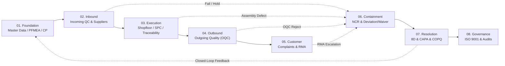
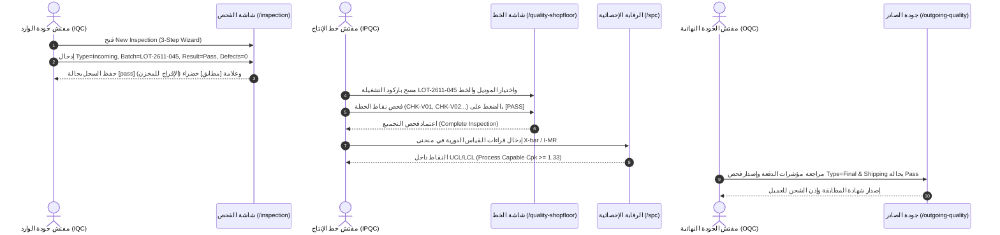
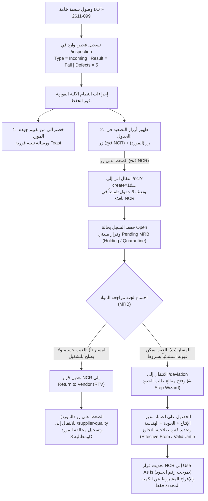
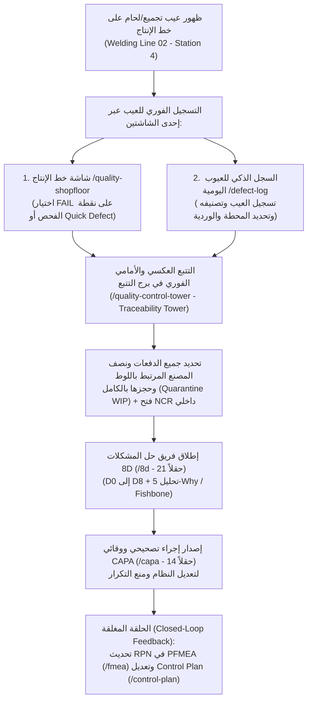
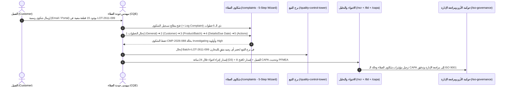

# الدليل التشغيلي التفصيلي الشامل لمنظومة إدارة الجودة الذكية (QMS 4.0)
**Standard Operating Procedure (SOP) & Step-by-Step Work Instruction — النسخة الكاملة غير المختصرة**

> [!IMPORTANT]
> **الغرض من هذه الوثيقة:**
> هذا الدليل هو **تعليمة عمل تشغيلية تفصيلية (Work Instruction)** تغطي دورة حياة المنتج بالكامل داخل منصة **QMS 4.0** من لحظة تأسيس البيانات الهندسية واستلام الخامات، مروراً بخطوط الإنتاج والتجميع والفحص النهائي، ووصولاً إلى العميل.
> تم توثيق **كل شاشة، وكل خطوة داخل معالجات التسجيل (Wizards)، وكل حقل إدخال (Field)، ونوعه، وخيارات القوائم المنسدلة (Dropdown Options)، وأزرار الإجراءات، والربط الآلي (Auto-Handoff)** بين الموديولات بالصور الفعلية من داخل النظام دون أي اختصار.

---

## فهرس المحتويات والسيناريوهات التشغيلية

1. **[نظرة عامة على بوابة منظومة الجودة (Quality Ecosystem Portal — `/ecosystem`)](#section-0)**
2. **[المرحلة التأسيسية (Stage 01): إعداد البيانات الهندسية والخطط قبل دخول الخامة](#stage-01)**
   - 0.1 سجل البيانات الأساسية وشجرة المنتج وكتالوج العيوب (`/quality/master-data`)
   - 0.2 تحليل أنماط الفشل وتأثيراتها للعمليات (`PFMEA` — `/fmea`)
   - 0.3 خطة الضبط والرقابة الهندسية (`Control Plan` — `/control-plan`)
   - 0.4 معايرة أجهزة القياس وتحليل منظومة القياس (`Calibration & MSA` — `/calibration`)
3. **[السيناريو الأول (Scenario 1): المسار المثالي (Golden Run) — خامة سليمة 100% من الاستلام حتى الشحن للعميل](#scenario-1)**
   - الخطوة 1.1: تسجيل فحص وارد مطابق (`Incoming QC - Pass`) عبر المعالج الثلاثي (3-Step Wizard) في `/inspection`
   - الخطوة 1.2: التسجيل اللحظي على خط الإنتاج (`Shopfloor Entry` — `/quality-shopfloor`) وفحص نقاط الخطة (`PASS`)
   - الخطوة 1.3: الرقابة الإحصائية للعمليات (`SPC Control Charts` — `/spc`) وتسجيل القراءات داخل حدود الضبط
   - الخطوة 1.4: الفحص النهائي وفحص ما قبل الشحن (`Outgoing Quality / FQC & OQC` — `/outgoing-quality` و `/inspection`) وإصدار إذن الإفراج
4. **[السيناريو الثاني (Scenario 2): خامة مرفوضة أو معلقة تحت القرار (Holding / Quarantine) في فحص الوارد](#scenario-2)**
   - الخطوة 2.1: تسجيل فحص وارد راسب (`Incoming QC - Fail`) في `/inspection` والتنبيه الآلي لتحديث تقييم المورد
   - الخطوة 2.2: التصعيد الآلي بضغطة زر واحدة (`فتح NCR`) وتعبئة البيانات تلقائياً في موديول عدم المطابقة (`/ncr`)
   - الخطوة 2.3: شرح كامل لجميع حقول نافذة عدم المطابقة (`Create New NCR` — 16 حقلاً تفصيلياً) ووضع الشحنة تحت قرار لجنة المراجعة (`Pending MRB`)
   - **المسار (أ): قرار الرفض النهائي وإرجاع الشحنة للمورد (`Return to Vendor - RTV`)**
     - تحديث تقييم المورد آلياً (`/supplier-quality` — زر `المورد`) وتسجيل مورد/مخالفة
   - **المسار (ب): القبول الاستثنائي المشروط بطلب حيود/تجاوز (`Deviation / Waiver Request` — `/deviation`)**
     - شرح تفصيلي لمعالج الحيود ذي الـ 4 خطوات (4-Step Wizard) واعتمادات مديري الإنتاج والجودة والهندسة
5. **[السيناريو الثالث (Scenario 3): خامة اجتازت الوارد وظهرت بها عيوب أثناء التجميع على خط الإنتاج (In-Process / Assembly Defects)](#scenario-3)**
   - الخطوة 3.1: اكتشاف العيب وتسجيله عبر شاشة خط الإنتاج (`/quality-shopfloor`) أو السجل الذكي للعيوب اليومية (`/defect-log`)
   - الخطوة 3.2: التتبع العكسي والأمامي الفوري وحجز التشغيلة عبر برج التتبع (`Traceability Control Tower` — `/quality-control-tower`)
   - الخطوة 3.3: فتح منهجية حل المشكلات (`8D Problem Solving` — `/8d`) — شرح كامل لـ 21 حقلاً من `D0` إلى `D8`
   - الخطوة 3.4: إطلاق الإجراءات التصحيحية والوقائية (`CAPA` — `/capa`) — شرح كامل لـ 14 حقلاً والربط المغلق مع `PFMEA` و `Control Plan`
6. **[السيناريو الرابع (Scenario 4): اكتشاف عيوب في الفحص النهائي أو ما قبل الشحن (Outgoing Quality — OQC)](#scenario-4)**
   - الخطوة 4.1: رصد العيب في بوابة الفحص النهائي (`/outgoing-quality` و `/inspection` بنوع `Final` أو `Shipping`) وإيقاف الشحن الفوري
   - الخطوة 4.2: إصدار تقرير عدم مطابقة داخلي (`/ncr`) بقرار إعادة تشغيل (`Rework`) أو إعدام (`Scrap`) وإعادة الفحص 100%
   - الخطوة 4.3: الاحتساب المالي لتكلفة الجودة الرديئة (`COPQ / Defect Cost` — `/defect-cost`)
7. **[السيناريو الخامس (Scenario 5): ظهور عيوب لدى العميل (Customer Complaint / RMA)](#scenario-5)**
   - الخطوة 5.1: تسجيل شكوى العميل عبر المعالج الخماسي الكامل (5-Step Wizard) في موديول شكاوى العملاء (`/complaints`)
   - الخطوة 5.2: الاحتواء الفوري خلال 24 ساعة (`D3 Containment`) وربط الشكوى بـ `NCR` و `8D` و `CAPA`
   - الخطوة 5.3: التغذية الراجعة في حوكمة الأيزو ومراجعة الإدارة (`ISO 9001 Governance` — `/iso-governance`)

---

<a id="section-0"></a>
## 1. نظرة عامة على بوابة منظومة الجودة الذكية (`Quality Ecosystem Portal`)
**المسار داخل النظام:** `/` أو `/ecosystem` أو `/quality-home`

تعمل هذه البوابة كلوحة قيادة تفاعلية (Interactive Command Matrix) تربط المراحل الثماني لمنظومة الجودة من التأسيس الهندسي (`Stage 01: Foundation`) وحتى حوكمة الأيزو (`Stage 08: Governance`).



### أوضاع العمل التفاعلية في البوابة (`/ecosystem`):
1. **الوضع القياسي (System Idle / Overview):** يعرض جميع الموديولات الـ 19 مرتبة داخل الـ 8 مراحل مع مؤشرات الحالة اللحظية (Live KPIs) ومسارات الربط الهندسي.
2. **وضع محاكاة مسار عدم المطابقة (`NCR ➔ 8D ➔ Return`):** يقوم بتشغيل محاكاة حية لمسار اكتشاف عيب في الوارد أو الإنتاج، فتح `NCR`، التصعيد إلى `8D` و `CAPA`، ثم تحديث `PFMEA` و `Control Plan` في حلقة مغلقة.
3. **وضع محاكاة مرتجعات العميل (`RMA ➔ 8D ➔ Return`):** يحاكي وصول شكوى عميل، إصدار `NCR` احتواء، تحليل `8D`، تحديث `CAPA`، وتعديل خطط الرقابة.
4. **وضع التركيز على موديول محدد (Node Spotlight):** عند النقر على أي بطاقة (مثل `Incoming QC`)، يقوم النظام بإضاءة كافة المدخلات والمخرجات المرتبطة بها فقط مع عرض لوحة تفاصيل في الأسفل تحتوي على:
   - **RECEIVES DATA FROM (المدخلات المستلمة):** مثل `Control Plan` و `Supplier Quality`.
   - **SENDS / TRIGGERS TO (المخرجات والتصعيدات):** مثل `NCR Management` و `Deviation / Waiver`.
   - زر **`Open Module`** للانتقال المباشر للموديول.

````carousel

<!-- slide -->

<!-- slide -->

<!-- slide -->

````

---

<a id="stage-01"></a>
## 2. المرحلة التأسيسية (Stage 01): إعداد البيانات الهندسية والخطط قبل دخول الخامة
قبل أن تستلم المخازن أو جودة الوارد أي شحنة خامات، يجب على **مهندس الجودة (QE)** و**مهندس العمليات** تجهيز البنية التحتية للبيانات في 4 شاشات أساسية:

### 0.1 إعداد البيانات الأساسية وكتالوج العيوب (`Master Data` — `/quality/master-data`)
- **الغرض:** تعريف الأصناف (Parts/Models)، شجرة المنتج (BOM)، محطات الفحص، و**كتالوج العيوب القياسي (Defect Catalog)** حتى لا يكتب المفتشون أسماء عيوب عشوائية.
- **التبويبات المتاحة داخل الشاشة:**
  1. `Models & Parts`: تعريف كود الصنف (مثل `SC-1050-2MM` لفائف صاج صلب سمك 2.00 مم، أو المنتج التام `Compressor Housing X1`).
  2. `BOM & Routing`: ربط الخامة بالمنتج التام ومحطات التشغيل (`Press Line 01`, `Welding Line 02`, `Final Assembly`).
  3. `Defect Catalog`: تعريف أكواد العيوب القياسية، فئاتها (`Dimensional`, `Surface`, `Visual`, `Functional`)، ودرجة خطورتها الافتراضية (`Critical`, `Major`, `Minor`).


### 0.2 تحليل أنماط الفشل وتأثيراتها (`PFMEA` — `/fmea`)
- **الغرض:** تقييم المخاطر الهندسية لكل خطوة عملية قبل بدء الإنتاج، وحساب رقم أولوية المخاطر (`RPN = Severity × Occurrence × Detection`) وأولوية الإجراء (`Action Priority - AP`).
- **البيانات التي يتم تسجيلها:**
  - `Process Step / Function`: خطوة العملية (مثل: استلام وتقطيع صاج 2.00 مم / كبس الغلاف).
  - `Potential Failure Mode`: نمط الفشل المحتمل (مثل: سمك الصاج أقل من الحد الأدنى `1.92 mm`).
  - `Potential Effect of Failure`: تأثير الفشل (مثل: شرخ في الغلاف أثناء الكبس العميق أو تسريب ضغط لدى العميل).
  - `Severity (S)` من 1 إلى 10 | `Potential Cause` | `Occurrence (O)` من 1 إلى 10 | `Current Prevention / Detection Controls` | `Detection (D)` من 1 إلى 10.
  - يقوم النظام آلياً بحساب `RPN` وتلوين المخاطر العالية باللون الأحمر لربطها بخطة الضبط (`Control Plan`).


### 0.3 خطة الضبط والرقابة الهندسية (`Control Plan` — `/control-plan`)
- **الغرض:** ترجمة مخرجات الـ `PFMEA` إلى تعليمات فحص ملزمة لمفتش الوارد ومفتش الخط ومفتش النهائي.
- **البيانات المسجلة في كل سطر رقابة:**
  - `Part / Process Number` و `Process Name / Operation Description`.
  - `Characteristic` (الخاصية المقاسة: مثل `Sheet Thickness` أو `Bore Diameter`).
  - `Special Char. Class` (تصنيف الخاصية: حرجة `CC` أو هامة `SC` أو قياسية).
  - `Specification / Tolerance` (المواصفة والـ Tolerance: مثل `2.00 mm ± 0.08 mm` أي من `1.92` إلى `2.08 mm`).
  - `Evaluation / Measurement Technique` (أداة القياس: مثل `Digital Micrometer CAL-MIC-04`).
  - `Sample Size & Frequency` (حجم العينة والتكرار: مثل `n = 20 pcs / Lot` في الوارد، أو `5 pcs / 2 Hours` في الخط).
  - `Control Method` (طريقة الضبط: مثل `Incoming Inspection Checklist` أو `X-bar & R Chart`).
  - `Reaction Plan` (خطة رد الفعل عند الحيود: مثل `Quarantine Lot + Open NCR + Notify MRB`).


### 0.4 معايرة أجهزة القياس (`Calibration & MSA` — `/calibration`)
- **الغرض:** التأكد من أن أداة القياس المستخدمة في الفحص (مثل الميكروميتر أو القدمة ذات الورنية) معايرة وصالحة (`Valid` / `Calibrated`) وأن دراسة `Gage R&R` مقبولة (< 10%).
- إذا كانت أداة القياس في حالة `Expired` أو `Out of Calibration`، يمنع النظام اعتماد قراءات الفحص الحرجة بها لحين معايرتها.


---

<a id="scenario-1"></a>
## 3. السيناريو الأول (Scenario 1): المسار المثالي (Golden Run) — خامة سليمة 100% من الاستلام حتى الشحن للعميل

في هذا السيناريو، تصل شحنة خامات سليمة (`Steel Coil 1.90mm - Grade A`، رقم التشغيلة `LOT-2611-045`)، وتمر عبر جميع بوابات الفحص بنجاح دون أي عيوب حتى تخرج للعميل.



---

### الخطوة 1.1: تسجيل فحص وارد مطابق (`Incoming QC - Pass`) في شاشة الفحص (`/inspection`)

1. **الدخول إلى الشاشة:** من القائمة الجانبية، اضغط على **`Inspection`** (أو انتقل إلى المسار `/inspection`).
2. **بدء تسجيل جديد:** اضغط على الزر الأزرق في أعلى اليمين **`+ New Inspection`**.
3. تفتح نافذة المعالج الذكي المكونة من **3 خطوات متتالية (`Step 1 of 3` ➔ `Step 2 of 3` ➔ `Step 3 of 3`)** (مع إمكانية التبديل للوضع الكامل عبر زر `DISABLE WIZARD MODE` في أعلى النافذة).

#### تفصيل الحقول في الخطوة الأولى (`Step 1 of 3: Inspection Details`):
| اسم الحقل في الشاشة (Field Label) | نوع الحقل والخيارات المتاحة (Type & Options) | القيمة المدخلة في هذا السيناريو | شرح الوظيفة والربط في النظام |
| :--- | :--- | :--- | :--- |
| **`Type *`** | قائمة منسدلة إلزامية (`Incoming`, `In-Process`, `Final`, `Shipping`) | **`Incoming`** | يحدد أن الفحص هو فحص استلام خامات واردة من مورد، مما يفعّل ربط السجل بموديول تقييم الموردين. |
| **`Product *`** | حقل نصي إلزامي (مزود بزر ميكروفون للإدخال الصوتي) | **`Steel Coil 1.90mm - Grade A`** | اسم الخامة أو الصنف المستلم كما هو معرف في `Master Data`. |
| **`Batch`** | حقل نصي (مزود بزر ميكروفون للإدخال الصوتي) | **`LOT-2611-045`** | رقم تشغيلة المورد أو لوط الاستلام الذي سيُستخدم في التتبع (`Traceability`) طوال دورة الإنتاج. |
| **`INSPECTION DATE`** | محدد تاريخ (Date Picker) | **`2026-11-06`** | تاريخ إجراء الفحص الفعلي في منطقة الاستلام. |
| **`Result`** | قائمة منسدلة (`Pass`, `Fail`, `Pending`) | **`Pass`** | القرار المبدئي/النهائي للفحص (مطابق للمواصفات). |

بعد ملء حقول الخطوة الأولى، اضغط على الزر الأزرق **`Next`** في أسفل يمين النافذة للانتقال إلى الخطوة الثانية.


---

#### تفصيل الحقول في الخطوة الثانية (`Step 2 of 3: Measurements & Findings`):
| اسم الحقل في الشاشة (Field Label) | نوع الحقل والخيارات المتاحة | القيمة المدخلة في هذا السيناريو | شرح الوظيفة والربط في النظام |
| :--- | :--- | :--- | :--- |
| **`Sample Size`** | رقمي (Number) | **`20`** | حجم العينة المسحوبة للفحص طبقاً لجدول `AQL` وخطة الضبط (`Control Plan`). |
| **`Defect Count`** | رقمي (Number) | **`0`** | إجمالي عدد القطع المعيبة المكتشفة في العينة (صفر في حالة المطابقة الكاملة). |
| **`Defect Type / نوع العيب`** | نصي + إدخال صوتي | *(يُترك فارغاً في حالة Pass)* | يُكتب فيه نوع العيب القياسي فقط في حالة وجود حيود. |
| **`Inspection Points`** | رقمي (Number) | **`5`** | عدد الخصائص الهندسية التي تم فحصها على كل عينة (السمك، العرض، استواء السطح، خلو من الصدأ، شهادة التحليل الكيميائي). |
| **`Inspected By`** | نصي + إدخال صوتي | **`Eng. Sara Ibrahim`** | اسم مهندس أو مفتش جودة الوارد المسؤول عن الفحص. |
| **`Notes / Defect Details`** | منطقة نصية متعددة الأسطر + إدخال صوتي | **`All 20 samples within tolerance (1.98mm - 2.02mm). Surface clean, mill certificate verified.`** | توثيق القراءات الفعلية المسجلة بالميكروميتر ومطابقة شهادة المنشأ. |

بعد إدخال القياسات، اضغط على زر **`Next`** للانتقال إلى الخطوة الثالثة (المراجعة النهائية).


---

#### الخطوة الثالثة (`Step 3 of 3: Additional Details & Final Submission`):
تعرض هذه الخطوة **ملخصاً كاملاً لجميع الحقول** في شاشة واحدة للمراجعة النهائية قبل الحفظ.
- اضغط على الزر الأخضر **`Create Inspection`** في أسفل يمين النافذة.


#### ماذا يحدث في النظام بعد الضغط على `Create Inspection`؟
1. تظهر رسالة تأكيد خضراء (Toast Notification) في أسفل الشاشة: **`Inspection created successfully`**.
2. يُضاف السجل فوراً في أعلى جدول الفحوصات بحالة **`pass`** باللون الأخضر، وعدد عيوب **`0 defects`**، وفي عمود **`ACTIONS / تصعيد`** تظهر علامة **`✓ مطابق`** باللون الأخضر.
3. يتم الإفراج آلياً عن التشغيلة `LOT-2611-045` لنقلها من منطقة الاستلام إلى مخزن الخامات المعتمدة وصرفها لخط الإنتاج.


---

### الخطوة 1.2: التسجيل اللحظي أثناء التشغيل والتجميع (`Shopfloor Entry` — `/quality-shopfloor`)

بمجرد صرف الخامة السليمة `LOT-2611-045` إلى خط الإنتاج، يقوم مفتش جودة الخط (`IPQC`) بمتابعة العملية عبر شاشة **`Shopfloor Entry`** المصممة للشاشات اللمسية والتابلت داخل المصنع:

1. **الدخول إلى الشاشة:** انتقل إلى **`Shopfloor Entry`** (`/quality-shopfloor`).
2. **أدوات الإدخال الذكي في أعلى الشاشة:**
   - زر **`AI Scanner`** (باللون البنفسجي): لفتح الكاميرا وقراءة الباركود أو فحص المنتج بالرؤية الحاسوبية.
   - شريط **`المسجل الصوتي الذكي (Q-Elite Voice Copilot)`**: يسمح للمفتش بنطق البيانات صوتياً باللغة العربية أو الإنجليزية (زر `ابدأ التحدث`) ليقوم النظام بملء الحقول تلقائياً دون استخدام اليدين.
3. **تحديد بيانات التشغيل (`Shift & Line Context`):**
   - **`Scan barcode or enter part...`** + زر **`Lookup`**: مسح باركود التشغيلة `LOT-2611-045` أو كود الصنف لاستدعاء خطة الفحص المرتبطة به آلياً.
   - **`QUANTITY`**: تحديد الكمية المفحوصة باستخدام أزرار **`-`** و **`+`**.
   - **`SHIFT`**: اختيار الوردية بالضغط على زر **`Morning`** أو **`Afternoon`** أو **`Night`**.
   - **`LINE`**: اختيار خط الإنتاج (مثل `Line 1 - Main Assembly`).
   - **`MODEL`**: اختيار موديل المنتج الجاري تجميعه (مثل `Model X1 - Standard`).
   - **`INSPECTION POINT`**: اختيار بوابة الفحص على الخط (مثل `In-Process Assembly` أو `End of Line`).
4. **تنفيذ قائمة فحص خطة الضبط (`Inspection Plan Checks`):**
   - يستدعي النظام بنود الفحص الإلزامية من `Control Plan` مع نسبة الإنجاز المئوية في الأعلى:
     - **`CHK-V01` (`Surface Finish Inspection` — Visual)**: فحص خلو السطح من الخدوش أو الصدمات ➔ يضغط المفتش على زر **`PASS`** الأخضر.
     - **`CHK-V02` (`Label Placement & Print Quality` — Visual)**: فحص دقة الملصق ووضوح الباركود ➔ يضغط المفتش على زر **`PASS`**.
     - **`CHK-D01` (`Overall Length Check` — Dimensional)**: قياس الطول الكلي بالقدمة `150.0mm ± 0.5mm` ➔ يضغط المفتش على زر **`PASS`**.
     - **`CHK-D02` (`Mounting Hole Diameter` — Dimensional)**: فحص قطر ثقوب التثبيت بـ Go/No-Go Gauge `8.0mm +0.1/-0.0` ➔ يضغط المفتش على زر **`PASS`**.
     - **`CHK-F01` (`Power-On Self Test` — Functional)**: اختبار التشغيل الذاتي ➔ يضغط المفتش على زر **`PASS`**.
5. **الحفظ والاعتماد:**
   - يضغط المفتش على زر **`Complete Inspection`** (أو **`Save Record`** / **`Save & New`** في الشريط السفلي) لاعتماد الدفعة وترحيلها للمرحلة التالية.


---

### الخطوة 1.3: الرقابة الإحصائية للعمليات (`SPC Control Charts` — `/spc`)

بالتوازي مع فحص القوائم، يقوم مهندس/مفتش الجودة بإدخال القياسات الرقمية الدورية في شاشة **`SPC`** (`/spc`) لمراقبة استقرار العملية ومؤشرات القدرة (`Cp` و `Cpk`):

1. **الدخول إلى الشاشة:** انتقل إلى **`SPC`** (`/spc`).
2. **اختيار الخاصية ونوع المنحنى:**
   - اختيار الخاصية المقاسة من القائمة (أو إضافة خاصية جديدة عبر زر **`+ Add Characteristic`** وتحديد `Nominal`, `USL`, `LSL`, `Subgroup Size`).
   - التبديل بين منحنى المتوسط والمدى (`X-bar & R Chart`) أو القراءات الفردية (`Switch to I-MR Chart`).
3. **إدخال القراءات اللحظية (`Record & Plot Reading`):**
   - إدخال قيم العينات المقاسة والضغط على **`Record & Plot Reading`**.
4. **التحقق الإحصائي الآلي (Nelson Rules & Capability):**
   - في هذا السيناريو السليم، تقع جميع النقاط بين الحد الأعلى للضبط (`UCL`) والحد الأدنى للضبط (`LCL`) حول خط المركز (`CL`)، وتظهر حالة العملية **`IN CONTROL`** باللون الأخضر مع قيمة **`Cpk ≥ 1.33`**، مما يؤكد عدم وجود أي انحراف في الماكينات.


---

### الخطوة 1.4: الفحص النهائي وفحص ما قبل الشحن (`Outgoing Quality` — `/outgoing-quality` و `/inspection`)

بعد انتهاء التجميع والتغليف، تنتقل الدفعة إلى بوابة **جودة الصادر (`Outgoing Quality - OQC`)**:

1. **الدخول إلى شاشة جودة الصادر:** انتقل إلى **`Outgoing Quality`** (`/outgoing-quality`) لمراجعة مؤشرات قبول الدفعات (`Lot Acceptance Rate %`) وحالة الشحنات الجاهزة.
2. **تسجيل تقرير الفحص النهائي وإذن الشحن:**
   - اضغط على زر الانتقال إلى الفحص أو افتح `/inspection` واضغط **`+ New Inspection`**.
   - اختر `Type = Final` (أو `Shipping`)، وأدخل رقم التشغيلة `LOT-2611-045`، و `Result = Pass`، و `Defect Count = 0`.
   - اضغط **`Create Inspection`**.
3. **النتيجة النهائية للسيناريو الأول:**
   - تحصل الشحنة على حالة **`pass / مطابق`** في الفحص النهائي، وتُطبع شهادة المطابقة (`Certificate of Conformance - CoC`)، وتخرج الشحنة للعميل بنسبة جودة **100% (First Pass Yield)**.


---

<a id="scenario-2"></a>
## 4. السيناريو الثاني (Scenario 2): خامة مرفوضة أو معلقة تحت القرار (Holding / Quarantine) في فحص الوارد

في هذا السيناريو، تصل شحنة خامات جديدة من المورد (`Steel Coil 1.90mm - Grade B`، رقم التشغيلة `LOT-2611-099`). أثناء فحص الاستلام (`IQC`)، يكتشف المفتش أن سمك الصاج الفعلي `1.82 mm` (أقل من الحد الأدنى المسموح به هندسياً `1.92 mm`) في 5 عينات من أصل 20 عينة، مع وجود صدأ سطحي.
يتم إيقاف الشحنة فوراً في منطقة العزل (`Quarantine / Holding Area`) لحين صدور قرار لجنة مراجعة المواد (`MRB`) التي تختار أحد مسارين:
- **المسار (أ): الرفض النهائي وإرجاع الشحنة للمورد (`Return to Vendor - RTV`)** مع خصم نقاط تقييم المورد آلياً.
- **المسار (ب): القبول الاستثنائي المشروط (`Conditional Acceptance via Deviation / Waiver`)** إذا كانت درجة الحيود تسمح بالتشغيل تحت شروط هندسية خاصة وبموافقة ثلاثية (مدير الإنتاج + مدير الجودة + مدير الهندسة).



---

### الخطوة 2.1: تسجيل فحص وارد راسب (`Incoming QC - Fail`) في شاشة الفحص (`/inspection`)

1. افتح شاشة **`Inspection`** (`/inspection`) واضغط على زر **`+ New Inspection`**.
2. في **الخطوة الأولى (`Step 1 of 3: Inspection Details`)**، أدخل البيانات التالية:
   - **`Type *`**: اختر **`Incoming`**.
   - **`Product *`**: اكتب **`Steel Coil 1.90mm - Grade B`**.
   - **`Batch`**: اكتب **`LOT-2611-099`**.
   - **`INSPECTION DATE`**: اختر **`2026-11-06`**.
   - **`Result`**: اختر **`Fail`** (أو اختر `Pending` إذا كنت تنتظر إعادة سحب عينة مضاعفة قبل تأكيد الرسوب).
   - اضغط **`Next`**.
3. في **الخطوة الثانية (`Step 2 of 3: Measurements & Findings`)**، أدخل تفاصيل العيب المكتشف بدقة:

| اسم الحقل في الشاشة (Field Label) | القيمة المدخلة في حالة الرسوب | الأهمية التشغيلية |
| :--- | :--- | :--- |
| **`Sample Size`** | **`20`** | حجم العينة المفحوصة. |
| **`Defect Count`** | **`5`** | عدد القطع المعيبة التي تجاوزت حد القبول (`Ac/Re`). |
| **`Defect Type / نوع العيب`** | **`Thickness below minimum (1.82mm vs 1.92mm min)`** | **مهم جداً:** هذا النص يظهر كشارة تحذيرية في الجدول وينتقل تلقائياً لوصف مشكلة الـ `NCR` عند التصعيد! |
| **`Inspection Points`** | **`5`** | عدد نقاط الفحص. |
| **`Inspected By`** | **`Eng. Ahmed Hassan`** | اسم مفتش الوارد الذي ضبط المخالفة. |
| **`Notes / Defect Details`** | **`5 out of 20 samples measured 1.81-1.83mm. Lot quarantined in Hold Area B2.`** | تحديد مكان حجز الشحنة فعلياً في المخزن (`Hold Area B2`). |

4. اضغط **`Next`** لمراجعة البيانات في **الخطوة الثالثة (`Step 3 of 3`)**، ثم اضغط على الزر الأخضر **`Create Inspection`**.

````carousel

<!-- slide -->

````

---

### ماذا يحدث في النظام فور الضغط على `Create Inspection` لفحص وارد راسب؟

بمجرد حفظ السجل بحالة `Fail` ونوع `Incoming`، يقوم محرك النظام بتنفيذ **3 إجراءات أوتوماتيكية في نفس اللحظة**:
1. **تحديث تقييم المورد آلياً:** يطلق النظام رسالة تنبيه زرقاء (Toast Notification):
   > **`"تم تحديث تقييم جودة المورد آلياً بناءً على حيود فحص الوارد"`**
   إلى جانب رسالة التأكيد الخضراء `Inspection created successfully`.
2. **تمييز السجل بصرياً في الجدول:**
   - تظهر شارة **`fail`** باللون الأحمر في عمود `RESULT`.
   - تظهر شارة **`5 defects`** باللون الأحمر مع شارة نوع العيب **`Thickness below minimum...`** باللون البرتقالي في عمود `DEFECTS / نوع العيب`.
3. **تفعيل أزرار التصعيد الذكي (`ACTIONS / تصعيد`):**
   بدلاً من كلمة `مطابق`، يظهر زرّان تفاعليان في عمود الإجراءات:
   - زر **`فتح NCR`** (باللون الأحمر): لفتح تقرير عدم مطابقة وتمرير بيانات الفحص إليه تلقائياً.
   - زر **`المورد`** (باللون الأزرق): للانتقال المباشر إلى ملف المورد في موديول جودة الموردين (`/supplier-quality`).


---

### الخطوة 2.2: الضغط على زر (`فتح NCR`) والتعبئة الآلية لبيانات عدم المطابقة (`/ncr`)

عندما يضغط مفتش جودة الوارد على الزر الأحمر **`فتح NCR`** أمام سطر الفحص الراسب:
1. يقوم النظام بتوجيه المتصفح تلقائياً إلى المسار التالي المزود بمعاملات الربط الذكي (URL Query Handoff):
   `/ncr?create=1&title=فشل فحص وارد: Steel Coil 1.90mm - Grade B&defectType=Thickness below minimum (1.82mm vs 1.92mm min)&line=Incoming Inspection&qty=5&lot=LOT-2611-099&desc=...&severity=major`
2. يفتح النظام شاشة **`Non-Conformance Reports (NCR)`** ويقوم **بفتح نافذة `Create New NCR` تلقائياً** مع ملء الحقول الأساسية باللغة العربية والإنجليزية من واقع تقرير الفحص دون الحاجة لإعادة كتابتها!

````carousel

<!-- slide -->

````

---

### الخطوة 2.3: شرح تفصيلي كامل لجميع حقول نافذة عدم المطابقة (`Create New NCR` — 16 حقلاً)

سواء تم فتح نافذة `Create New NCR` تلقائياً عبر زر `فتح NCR` من شاشة الفحص، أو يدوياً عبر زر **`+ New NCR`** في شاشة `/ncr`، تحتوي النافذة على **16 حقلاً هندسياً وإدارياً** مقسمة وظيفياً كالتالي:

| # | اسم الحقل في الشاشة (Field Label) | نوع الحقل والخيارات المتاحة (Dropdown Options) | القيمة المسجلة في السيناريو | وظيفة الحقل وكيفية استخدامه في حالة الرفض أو الهولدنج (Holding) |
| :-: | :--- | :--- | :--- | :--- |
| **1** | **`NCR Title *`** | نصي إلزامي | `Incoming Steel Coil Thickness Out of Spec (1.82mm)` | عنوان واضح ومختصر لحالة عدم المطابقة (يُملأ آلياً عند التصعيد من الفحص). |
| **2** | **`Defect Type`** | نصي | `Dimensional / Geometry` | تصنيف العيب القياسي لربطه بتحليلات باريتو (`Pareto Analysis`). |
| **3** | **`Status`** | قائمة منسدلة:<br>• `Open`<br>• `In Progress`<br>• `Under Review`<br>• `Disposition`<br>• `Closed` | **`Open`** (أو `Under Review` أثناء الهولدنج) | يحدد مرحلة التقرير الحالية: يبدأ بـ `Open` عند الضبط، ويتحول إلى `Under Review` أثناء دراسة لجنة `MRB`، ثم `Disposition` عند صدور القرار، وأخيراً `Closed` بعد تنفيذ الإجراء. |
| **4** | **`Severity`** | قائمة منسدلة:<br>• `Critical`<br>• `Major`<br>• `Minor` | **`Major`** | درجة خطورة العيب على سلامة المنتج أو قابليته للتشغيل. |
| **5** | **`Priority`** | قائمة منسدلة:<br>• `Critical`<br>• `High`<br>• `Medium`<br>• `Low` | **`High`** | أولوية المعالجة (عالية لأن الشحنة متوقفة في أرضية الاستلام). |
| **6** | **`Production Line`** | نصي | `Press Line 01 - Incoming` | منطقة الاكتشاف أو الخط المتأثر. |
| **7** | **`Affected Quantity`** | رقمي | **`500`** | إجمالي كمية اللوط المحجوزة بالكامل (مثلاً 500 كجم أو 500 لوح). |
| **8** | **`Lot Number`** | نصي | **`LOT-2611-099`** | رقم التشغيلة المعزولة لمنع صرفها على النظام. |
| **9** | **`Assigned To`** | نصي | `Eng. Mahmoud Reda (SQE)` | مهندس جودة الموردين (`SQE`) المكلف بمتابعة الملف. |
| **10** | **`Department`** | نصي | `Supplier Quality / IQC` | القسم المسؤول عن تنفيذ الاحتواء والقرار. |
| **11** | **`Due Date`** | تاريخ (Date) | `2026-11-10` | الموعد النهائي لإغلاق حالة عدم المطابقة. |
| **12** | **`Description`** | منطقة نصية (Textarea) | `Incoming steel coil thickness measured at 1.82mm against specification 2.00mm +/- 0.08mm.` | الوصف الهندسي التفصيلي للحيود بالمقارنة مع المواصفة القياسية. |
| **13** | **`Containment Action`** *(خلفية صفراء)* | منطقة نصية (Textarea) | `Quarantined entire lot LOT-2611-099 in Red Hold Area B2. Attached Red Hold Tag #HT-904. Blocked ERP release.` | **إجراء الاحتواء الفوري (إلزامي):** توثيق عزل الشحنة في منطقة الحجر (`Quarantine`) وتعليق كارت الإيقاف الأحمر (`Red Hold Tag`). |
| **14** | **`Disposition Decision`** *(خلفية برتقالية)* | قائمة منسدلة:<br>• `Pending MRB`<br>• `Rework`<br>• `Scrap`<br>• `Return to Vendor`<br>• `Use As Is` | • في حالة **الهولدنج (تحت القرار)**: يُختار **`Pending MRB`**.<br>• في حالة **الرفض النهائي**: يُختار **`Return to Vendor`**.<br>• في حالة **القبول بتجاوز**: يُختار **`Use As Is`**. | **أهم حقل قرار في الشاشة:** يحدد مصير الخامة المحجوزة. |
| **15** | **`Disposition Notes`** | نصي | `MRB approved full RTV. Debit note #DN-2026-112 issued.` | رقم محضر اجتماع لجنة `MRB` أو رقم إشعار الخصم المالي (`Debit Note`) أو رقم طلب الحيود (`Deviation ID`). |
| **16** | **`Root Cause Investigation Notes`** *(خلفية زرقاء)* | منطقة نصية (Textarea) | `Supplier rolling mill gauge sensor drift during batch production.` | نتائج التحقيق المبدئي في السبب الجذري تمهيداً لفتح `8D`. |

بعد استكمال الحقول، اضغط على زر **`Create NCR`** في أسفل يمين النافذة.

````carousel

<!-- slide -->

<!-- slide -->

````

---

### تفرع القرار بعد حجز الخامة (`MRB Decision Branches`):

#### المسار (أ): قرار الرفض النهائي وإرجاع الشحنة للمورد (`Return to Vendor - RTV`) ومتابعة المورد (`/supplier-quality`)
إذا قررت لجنة مراجعة المواد (`MRB`) رفض الشحنة نهائياً:
1. في بطاقة الـ `NCR`، يتم تحديد `Disposition Decision = Return to Vendor`.
2. من شاشة الفحص (`/inspection`)، اضغط على الزر الأزرق **`المورد`** أمام الشحنة المرفوضة (أو انتقل إلى **`Supplier Quality`** عبر المسار `/supplier-quality`).
3. في شاشة `/supplier-quality`:
   - يمكنك مراجعة مؤشرات أداء المورد (`Quality Score %`, `On-Time Delivery %`, `Defect Rate PPM`) التي تم تحديثها آلياً بعد رسوب الفحص.
   - لإضافة مورد جديد أو تحديث بيانات اعتماد مورد، اضغط على زر **`+ Add Supplier`** لملء بياناته (`Supplier Name *`, `Code`, `Category`, `Status` [`Approved`, `Conditional`, `Probation`, `Disqualified`], `ISO Status`, `Contact Person`, `Email`, `Phone`, `Quality Score %`, `On-Time Delivery %`, `Defect Rate (PPM)`, `Last Audit Date`, `Next Audit Date`, `Notes`).
   - يتم إرسال إخطار رسمي للمورد (`SCAR / Supplier 8D Request`) لإرجاع اللوط `LOT-2611-099` واسترداد قيمته المالية.

````carousel

<!-- slide -->

````

---

#### المسار (ب): القبول الاستثنائي المشروط بطلب حيود/تجاوز هندسي (`Deviation / Waiver Request` — `/deviation`)

ماذا لو كانت الخامة المحجوزة في الهولدنج بها حيود طفيف (مثلاً سمك الصاج `1.90 mm` بدلاً من `1.92 mm`) وخط الإنتاج مهدد بالتوقف، وأثبتت الإدارة الهندسية أن هذا الحيود لن يؤثر على الأمان الوظيفي للمنتج إذا تم تقليل سرعة مكبس التشكيل بنسبة 15%؟
في هذه الحالة **يُمنع منعاً باتاً** الإفراج عن الخامة شفوياً، بل يجب إصدار **تصريح حيود/تجاوز رسمي موثق (`Deviation / Waiver Request`)** عبر المسار `/deviation`:

1. **الدخول إلى الشاشة:** انتقل إلى **`Deviation / Waiver`** (`/deviation`).
2. **بدء طلب جديد:** اضغط على الزر الأزرق **`+ Request Deviation`** في أعلى اليمين.
3. يفتح النظام **معالج اعتماد الحيود المكون من 4 خطوات إلزامية (`Step 1 of 4` إلى `Step 4 of 4`)**:

##### الخطوة 1 من 4 (`Step 1 of 4: General Information` — البيانات الأساسية):
| اسم الحقل (Field Label) | نوع الحقل والخيارات المتاحة | القيمة المدخلة في السيناريو | الشرح |
| :--- | :--- | :--- | :--- |
| **`Deviation ID *`** | نصي إلزامي | **`DEV-2026-019`** | الرقم المرجعي الفريد لتصريح التجاوز. |
| **`Deviation Type *`** | قائمة منسدلة:<br>• `Temporary`<br>• `Permanent`<br>• `Emergency` | **`Temporary`** | نوع الحيود: مؤقت (تجاوز لدفعة محددة أو فترة محددة)، دائم (يتطلب تعديل الرسم الهندسي لاحقاً)، أو طارئ. |
| **`Status *`** | قائمة منسدلة:<br>• `Draft`<br>• `Submitted`<br>• `Under Review`<br>• `Approved`<br>• `Rejected`<br>• `Expired` | **`Approved`** (بعد استكمال التوقيعات) | حالة الطلب في دورة الاعتماد. |
| **`Requestor *`** | نصي إلزامي | **`Eng. Tarek Mansour`** | اسم المهندس مقدم طلب التجاوز. |
| **`REQUEST DATE *`** | تاريخ إلزامي | **`2026-11-06`** | تاريخ تقديم الطلب. |

اضغط **`Next`** للانتقال للخطوة الثانية.


---

##### الخطوة 2 من 4 (`Step 2 of 4: Deviation Details` — تفاصيل الحيود والدفعات المتأثرة):
| اسم الحقل (Field Label) | نوع الحقل | القيمة المدخلة في السيناريو | الشرح |
| :--- | :--- | :--- | :--- |
| **`Process/Procedure Name *`** | نصي إلزامي | **`Incoming Steel Sheet Stamping SOP-ST-04`** | اسم العملية أو المواصفة القياسية التي سيتم الحيود عنها مؤقتاً. |
| **`Product Name *`** | نصي إلزامي | **`Compressor Housing Model X1`** | اسم المنتج الذي ستدخل فيه هذه الخامة. |
| **`Deviation Description *`** | منطقة نصية إلزامية | **`Accept temporary thickness of 1.90mm instead of 1.92mm min for 200 units only.`** | تحديد سقف التجاوز بدقة (القياس المسموح به والكمية القصوى المسموح بتشغيلها: 200 قطعة فقط). |
| **`Reason for Deviation *`** | منطقة نصية إلزامية | **`Urgent customer delivery schedule and validated FEA structural safety margin.`** | المبرر التجاري والهندسي لطلب الاستثناء. |
| **`Affected Products/Lots`** | نصي | **`LOT-2611-099 (Sub-batch A: 200 pcs)`** | ربط التصريح برقم اللوط المحجوز في الـ `NCR` لمنع استخدام التصريح لأي شحنة أخرى. |

اضغط **`Next`** للانتقال للخطوة الثالثة.


---

##### الخطوة 3 من 4 (`Step 3 of 4: Risk Assessment` — تقييم المخاطر وخطة التخفيف):
| اسم الحقل (Field Label) | نوع الحقل | القيمة المدخلة في السيناريو | الشرح |
| :--- | :--- | :--- | :--- |
| **`Risk Level *`** | نصي / تصنيف إلزامي | **`Medium`** | مستوى المخاطرة الناتج عن تشغيل الخامة بهذا التجاوز. |
| **`Impact on Quality`** | منطقة نصية | **`No functional impact on burst pressure test up to 45 bar.`** | الأثر على جودة وأداء المنتج النهائي بناءً على الاختبارات المعملية. |
| **`Risk Analysis *`** | منطقة نصية إلزامية | **`FEA simulation confirms safety factor remains 2.4x (above 2.0x minimum requirement).`** | التحليل الهندسي الداعم لقرار القبول المشروط. |
| **`Risk Mitigation Plan *`** | منطقة نصية إلزامية | **`100% ultrasonic wall thickness check after deep drawing + reduce press speed by 15%.`** | **الشرط الإلزامي للتشغيل:** الضوابط الإضافية التي سيلتزم بها خط الإنتاج ومفتش الجودة أثناء تشغيل هذه الدفعة. |

اضغط **`Next`** للانتقال للخطوة الرابعة والأخيرة.


---

##### الخطوة 4 من 4 (`Step 4 of 4: Approvals & Validity` — التوقيعات الثلاثية وفترة الصلاحية الزمنية):
| اسم الحقل (Field Label) | نوع الحقل | القيمة المدخلة في السيناريو | الشرح |
| :--- | :--- | :--- | :--- |
| **`Production Manager Approval *`** | نصي إلزامي | **`Eng. Khaled Mansour - Approved`** | توقيع واعتماد مدير الإنتاج بالتزام الخط بشروط التشغيل الخاصة (خفض سرعة المكبس 15%). |
| **`Quality Manager Approval *`** | نصي إلزامي | **`Eng. Hany Adel - Approved`** | توقيع واعتماد مدير الجودة بالالتزام بفحص 100% بالموجات فوق الصوتية. |
| **`Engineering Manager Approval *`** | نصي إلزامي | **`Dr. Sherif Nabil - Approved`** | توقيع واعتماد مدير الهندسة على سلامة التصميم تحت هذا التجاوز. |
| **`EFFECTIVE FROM *`** | تاريخ إلزامي | **`2026-11-06`** | تاريخ بدء سريان التصريح. |
| **`VALID UNTIL *`** | تاريخ إلزامي | **`2026-11-20`** | **تاريخ انتهاء الصلاحية:** بعد هذا التاريخ يتحول التصريح تلقائياً إلى `Expired` ويُمنع استخدام أي رصيد متبقٍ من الخامة. |

اضغط على الزر الأخضر **`Create Deviation Request`** لإصدار التصريح رسمياً، ثم ارجع إلى بطاقة الـ `NCR` وقم بتحديث القرار (`Disposition Decision`) من `Pending MRB` إلى **`Use As Is`** مع كتابة رقم التصريح `DEV-2026-019` في حقل `Disposition Notes`.

````carousel

<!-- slide -->

````


---

<a id="scenario-3"></a>
## 5. السيناريو الثالث (Scenario 3): خامة اجتازت الوارد وظهرت بها عيوب أثناء التجميع على خط الإنتاج (In-Process / Assembly Defects)

في هذا السيناريو، اجتازت الخامة أو المكونات فحص الوارد ودخلت إلى خط التجميع واللحام (`Welding Line 02 - Station 4`). أثناء عملية التجميع والفحص المرحلي (`In-Process QC`)، اكتشف المفتش ظهور **مسامية وضعف في لحام غلاف الضاغط (`Weld Porosity & Spatter`)** ورسوب في اختبار تسريب الضغط بنسب غير طبيعية (18 قطعة معيبة في الوردية الصباحية من التشغيلة `LOT-2611-099`).



---

### الخطوة 3.1: رصد وتسجيل العيب على خط التجميع (`/quality-shopfloor` و `/defect-log`)

يتيح النظام لمفتش خط الإنتاج ومهندس جودة التشغيل طريقتين متكاملتين لتسجيل عيوب التجميع فور ظهورها:

#### الطريقة الأولى: التسجيل اللحظي من شاشة خط الإنتاج (`Shopfloor Entry` — `/quality-shopfloor`)
1. أثناء تنفيذ قائمة الفحص (`Inspection Plan Checks`) في شاشة `/quality-shopfloor`:
   - عند البند الذي رسب فيه التجميع (مثلاً `CHK-V01` أو `CHK-F01`)، يضغط المفتش على الزر الأحمر **`FAIL`** بدلاً من `PASS`.
2. في قسم **`Quick Defect`** على يسار الشاشة:
   - يمكن للمفتش الضغط على زر **`AI Camera`** لتصوير عيب التجميع مباشرة، أو زر **`Hands-Free`** لنطق اسم العيب صوتياً.
   - أو كتابة اسم العيب في حقل `Enter defect type...` وتحديد درجة الخطورة (`Minor` / `Major` / `Critical`) والكمية المعيبة ثم الضغط على زر **`+`**.
   - أو اختيار أحد أزرار العيوب السريعة الجاهزة أسفل الحقل (`Scratch`, `Dent`, `Color Mismatch`, `Dimension Out`, `Missing Part`, `Poor Finish`).
3. الضغط على **`Add Photo / File`** لإرفاق صورة العيب، ثم الضغط على **`Save Record`**.

#### الطريقة الثانية: السجل الذكي للعيوب اليومية وحوكمة دورة حياة العيب (`Smart Daily Defect Recorder` — `/defect-log`)
للتحليل التفصيلي وإدارة دورة حياة العيوب اليومية عبر الورديات، انتقل إلى **`Defect Log`** (`/defect-log`):
- تحتوي هذه الشاشة على **7 تبويبات متكاملة**:
  1. **`New Entry` (تسجيل عيب جديد):** يدعم وضع النموذج التفصيلي (`Form View`) أو وضع الإدخال الجماعي السريع بنظام الجداول (`Grid View (Mass Entry)`) لتسجيل عشرات العيوب في ثوانٍ.
  2. **`Defect Records` (سجل العيوب):** عرض وفلترة جميع عيوب التجميع المسجلة مع أزرار تصعيد مباشر إلى `NCR` أو `CAPA`.
  3. **`Lifecycle Details` (تفاصيل دورة حياة العيب):** متابعة حالة كل عيب من لحظة الرصد وحتى الإغلاق.
  4. **`Workflow Dashboard` (لوحة سير العمل):** متابعة معدلات العيوب حسب الخط والوردية.
  5. **`My Tasks` (مهامي):** المهام المسندة لمهندس الجودة لمعالجة العيوب المفتوحة.
  6. **`Governance Settings` (إعدادات الحوكمة):** ضبط حدود التنبيه الآلي (`Thresholds`) التي تفرض فتح `NCR` أو `8D` إجبارياً إذا تكرر نفس عيب التجميع أكثر من عدد معين في الوردية.
  7. **`Pareto Analysis` (تحليل باريتو 80/20):** رسم بياني آلي يحدد أهم 20% من أسباب العيوب المسؤولة عن 80% من مشاكل التجميع.


---

### الخطوة 3.2: التتبع العكسي والأمامي وحجز الدفعات عبر برج التتبع (`Traceability Control Tower` — `/quality-control-tower`)

بمجرد اكتشاف عيب أثناء التجميع، يجب فوراً الإجابة على سؤالين حاسمين:
1. **التتبع العكسي (Backward Traceability):** ما هي تشغيلة الخامة (`Raw Material Lot`)، ومن هو المورد، وما هي الماكينة وفني التشغيل وأداة القياس التي مرت عليها هذه القطع المعيبة؟
2. **التتبع الأمامي (Forward Traceability):** هل توجد دفعات أخرى على الخط (`WIP`) أو في مخزن المنتج التام تم تجميعها من نفس تشغيلة الخامة أو على نفس إعدادات الماكينة وتحتاج إلى حجز فوري قبل أن تصل للعميل؟

**خطوات التنفيذ في النظام:**
1. انتقل إلى **`Traceability Tower`** (`/quality-control-tower`).
2. في شريط البحث العلوي، أدخل رقم التشغيلة (`LOT-2611-099`) أو الرقم التسلسلي للقطعة (`Serial Number`).
3. يعرض قسم **`Live Lot & Material Traceability Flow`** شجرة التتبع الكاملة من المورد ➔ فحص الوارد ➔ محطات التشغيل والتجميع ➔ حالة الـ `NCR` و `CAPA` المرتبطة باللوط، ممايمكّن مهندس الجودة من حجز جميع الكميات المشتبه بها (`WIP Quarantine`) في دقائق معدودة.


---

### الخطوة 3.3: فتح منهجية حل المشكلات الجذرية (`8D Problem Solving` — `/8d`) — شرح كامل لـ 21 حقلاً

بعد حجز الكميات المعيبة وفتح تقرير عدم مطابقة داخلي (`/ncr`)، يتطلب عيب التجميع المتكرر أو الجسيم تشكيل فريق متعدد التخصصات (`Cross-Functional Team`) لحل المشكلة جذرياً باستخدام منهجية **`8D Problem Solving`**:

1. **الدخول إلى الشاشة:** انتقل إلى **`8D Problem Solving`** (`/8d`).
2. **بدء تقرير 8D جديد:** اضغط على الزر الأزرق **`+ New 8D`** في أعلى اليمين.
3. تفتح نافذة **`Create New 8D Report`** التي تضم **21 حقلاً هندسياً تغطي المراحل من `D0` إلى `D8` بالكامل**:

| # | اسم الحقل في الشاشة (Field Label) | نوع الحقل والخيارات المتاحة (Dropdown Options) | القيمة المدخلة في سيناريو عيب التجميع | المرحلة المقابلة في منهجية 8D وشرح الاستخدام |
| :-: | :--- | :--- | :--- | :--- |
| **1** | **`Problem Title *`** | نصي إلزامي | `Weld Porosity on Compressor Housing Assembly` | عنوان المشكلة الهندسية قيد التحقيق. |
| **2** | **`8D Number`** | نصي (يُولد تلقائياً أو يُعدل) | `8D-2026-5948` | الرقم المرجعي لتقرير الـ 8D. |
| **3** | **`Status Phase`** | قائمة منسدلة لـ 10 مراحل:<br>• `D0: Plan`<br>• `D1: Team`<br>• `D2: Problem`<br>• `D3: Containment`<br>• `D4: Root Cause`<br>• `D5: Corrective`<br>• `D6: Validate`<br>• `D7: Prevent`<br>• `D8: Congratulate`<br>• `Closed` | **`D4: Root Cause`** (أو المرحلة الحالية للفريق) | يحدد المرحلة التي وصل إليها فريق حل المشكلة حالياً، ويظهر كشريط تقدم (`Progress Bar`) على بطاقة الـ 8D. |
| **4** | **`Analysis Method`** | قائمة منسدلة:<br>• `5-Why Analysis`<br>• `Fishbone (Ishikawa)`<br>• `FMEA`<br>• `Fault Tree`<br>• `Pareto Analysis` | **`5-Why Analysis`** | الأداة التحليلية المستخدمة للوصول للسبب الجذري. |
| **5** | **`Effectiveness Check`** | قائمة منسدلة:<br>• `Pending`<br>• `Effective`<br>• `Ineffective` | **`Effective`** (بعد التحقق في D6) | نتيجة فحص فعالية الإجراءات التصحيحية بعد تطبيقها. |
| **6** | **`Team Leader *`** | نصي إلزامي | `Eng. Omar Farouk (Lead QE)` | **`D1 (Establish the Team)`**: قائد فريق حل المشكلة. |
| **7** | **`Champion`** | نصي | `Eng. Hany Adel (Quality Director)` | الراعي الإداري للفريق (لإزالة العقبات واعتماد الموارد). |
| **8** | **`Members (comma separated)`** | نصي | `M. Saeed (Production), K. Nabil (Maintenance), R. Taha (Process Eng)` | أعضاء الفريق من أقسام الإنتاج، الصيانة، وهندسة العمليات. |
| **9** | **`Product / Part`** | نصي | `Compressor Housing Model X1` | اسم المنتج أو الجزء المتأثر بعيب التجميع. |
| **10** | **`Production Line`** | نصي | `Welding Line 02 - Station 4` | خط ومحطة التجميع التي ظهر بها العيب. |
| **11** | **`Lot Number`** | نصي | `LOT-2611-099` | رقم التشغيلة المتأثرة. |
| **12** | **`Source NCR`** | نصي (ربط مرجعي) | `NCR-2026-842` | **الربط المباشر:** رقم تقرير الـ `NCR` الذي فجّر هذا التحقيق. |
| **13** | **`D2 - Problem Description`** | منطقة نصية | `5W2H: High porosity and spatter detected on circumferential weld seam during pressure leak test (18 units failed in Morning Shift).` | **`D2 (Describe the Problem)`**: صياغة المشكلة بمنهجية `5W2H` (ماذا، أين، متى، من، لماذا، كيف، وكم عدد القطع المعيبة). |
| **14** | **`D3 - Containment Action (ICA)`** | منطقة نصية | `100% X-ray and pneumatic leak testing at 12 bar for all WIP batches from Welding Line 02.` | **`D3 (Interim Containment Action)`**: إجراء الاحتواء المؤقت لحماية العميل والخطوط اللاحقة لحين تطبيق الحل الجذري. |
| **15** | **`Contained Qty`** | رقمي | **`320`** | إجمالي عدد القطع التي تم فحصها واحتواؤها في خطوة `D3`. |
| **16** | **`D4 - Root Cause`** | منطقة نصية | `Shielding gas (Argon/CO2) flow rate dropped to 6 L/min due to clogged solenoid valve filter and worn regulator seal.` | **`D4 (Root Cause Analysis)`**: السبب الجذري التقني الذي أدى لظهور مسامية اللحام. |
| **17** | **`5-Why Breakdown`** | منطقة نصية متعددة الأسطر | `Why 1: Porosity in weld seam -> Why 2: Atmospheric oxygen contamination in weld pool -> Why 3: Shielding gas flow below 15 L/min -> Why 4: Solenoid filter clogged with oil mist -> Why 5: Filter replacement not included in weekly PM checklist.` | **تحليل اللماذات الخمس (`5-Why`):** التدرج المنطقي من العَرَض الظاهري (`Why 1`) حتى السبب النظامي في خطة الصيانة الوقائية (`Why 5`). |
| **18** | **`D5 - Corrective Actions (PCA)`** | منطقة نصية | `Install digital inline mass-flow sensor with automatic PLC machine interlock if gas flow drops below 14 L/min.` | **`D5 (Permanent Corrective Actions)`**: الحل الهندسي الدائم (`Poka-Yoke` / منع الخطأ تلقائياً عبر حساس تدفق يوقف ماكينة اللحام آلياً إذا انخفض الغاز). |
| **19** | **`D6 - Validation Results`** | منطقة نصية | `3 consecutive shifts (1,500 units) produced with zero porosity defects. Cpk improved from 0.89 to 1.68.` | **`D6 (Implement & Validate PCA)`**: إثبات نجاح الحل بالأرقام ومؤشر القدرة `Cpk` عبر 3 ورديات متتالية. |
| **20** | **`D7 - Preventive Plan`** | منطقة نصية | `Updated PFMEA #PF-W02 (RPN reduced from 180 to 36) and Control Plan #CP-W02 to include daily gas flow verification.` | **`D7 (Prevent Recurrence)`**: تحديث وثائق الـ `PFMEA` و `Control Plan` وخطط الصيانة الوقائية على جميع خطوط اللحام المماثلة. |
| **21** | **`D8 - Lessons Learned`** | منطقة نصية | `Standardized inline gas flow interlock across all 6 robotic welding cells in Plant 1 & Plant 2.` | **`D8 (Congratulate Team & Lessons Learned)`**: تعميم الدروس المستفادة أفقياً (`Yokoten`) على باقي خلايا الإنتاج. |

اضغط على زر **`Create 8D`** لحفظ التقرير وإصدار بطاقة الـ `8D` التفاعلية.

````carousel

<!-- slide -->

````

---

### الخطوة 3.4: إطلاق الإجراءات التصحيحية والوقائية (`CAPA` — `/capa`) — شرح كامل لـ 14 حقلاً والربط المغلق

لتحويل مخرجات المرحلتين `D5` و `D7` من تقرير الـ `8D` إلى مهام تنفيذية ملزمة بمواعيد استحقاق ومُلاك محددين ومتابعة تحقق من الفعالية، يتم تسجيل **`CAPA`** رسمي في المسار `/capa`:

1. **الدخول إلى الشاشة:** انتقل إلى **`CAPA`** (`/capa`).
2. **بدء سجل جديد:** اضغط على الزر الأزرق **`+ New CAPA`** في أعلى اليمين.
3. تفتح نافذة **`Create New CAPA`** التي تضم **14 حقلاً تفصيلياً**:

| # | اسم الحقل في الشاشة (Field Label) | نوع الحقل والخيارات المتاحة (Dropdown Options) | القيمة المدخلة في السيناريو | شرح الوظيفة |
| :-: | :--- | :--- | :--- | :--- |
| **1** | **`CAPA Title *`** | نصي إلزامي | `Install Automated Shielding Gas Flow Interlock on Welding Cells` | عنوان الإجراء التصحيحي/الوقائي. |
| **2** | **`Action Type`** | قائمة منسدلة:<br>• `Corrective`<br>• `Preventive` | **`Corrective`** | يحدد ما إذا كان الإجراء تصحيحياً (لمنع تكرار مشكلة حدثت بالفعل) أو وقائياً (لمنع خطر محتمل). |
| **3** | **`Status Phase`** | قائمة منسدلة:<br>• `Identified`<br>• `Analysis`<br>• `Action`<br>• `Verification`<br>• `Closed` | **`Verification`** | مرحلة تقدم الـ CAPA الحالية. |
| **4** | **`Priority`** | قائمة منسدلة:<br>• `Critical`<br>• `High`<br>• `Medium`<br>• `Low` | **`High`** | أولوية التنفيذ والمتابعة. |
| **5** | **`Target Date`** | تاريخ (Date) | `2026-11-15` | التاريخ المستهدف لإنجاز الإجراء بالكامل. |
| **6** | **`Owner`** | نصي | `Eng. Karim Nabil (Maintenance Lead)` | الشخص المسؤول مباشرة عن تنفيذ الإجراء. |
| **7** | **`Department`** | نصي | `Maintenance & Process Engineering` | الإدارة المسؤولة. |
| **8** | **`Source NCR ID`** | نصي (ربط مرجعي) | `NCR-2026-842` | ربط الـ CAPA بتقرير عدم المطابقة الأصلي. |
| **9** | **`Problem Statement`** | منطقة نصية | `Recurring weld porosity defects on Line 02 caused by unmonitored shielding gas pressure drops.` | بيان المشكلة المراد القضاء على سببها الجذري. |
| **10** | **`Root Cause`** | منطقة نصية | `Absence of automated low-flow interlock and missing PM schedule for gas solenoid filters.` | السبب الجذري المستخلص من تحليل الـ `8D`. |
| **11** | **`5-Why Analysis`** | منطقة نصية | `1. Weld porosity -> 2. Low Argon flow -> 3. Clogged filter -> 4. No pressure switch -> 5. Omitted in equipment design FMEA.` | توثيق سلسلة اللماذات الخمس داخل سجل الـ CAPA. |
| **12** | **`Corrective Action Plan`** | منطقة نصية | `1. Retrofit digital flow switch IFM-SD6000 wired to PLC stop circuit. 2. Replace all solenoid filters on Lines 01-04.` | خطوات الفعل التصحيحي الهندسي المباشر. |
| **13** | **`Preventive Action Plan`** | منطقة نصية | `1. Add weekly filter inspection to PM module. 2. Update PFMEA and Control Plan across all welding lines.` | خطوات الفعل الوقائي وتحديث الوثائق لمنع ظهور المشكلة في خطوط أخرى. |
| **14** | **`Effectiveness Verification`** | قائمة منسدلة:<br>• `Pending Verification`<br>• `Effective`<br>• `Ineffective` | **`Effective`** | لا يُسمح بإغلاق الـ CAPA نهائياً إلا بعد تحول هذا الحقل إلى `Effective` بعد فترة المراقبة المحددة. |

اضغط على زر **`Create CAPA`** لحفظ السجل. وبمجرد تنفيذ البند الوقائي، يعود مهندس الجودة إلى شاشة **`PFMEA`** (`/fmea`) لخفض درجة التكرار والاكتشاف (`Occurrence & Detection`) مما يخفض الـ `RPN`، ويحدّث شاشة **`Control Plan`** (`/control-plan`) لإضافة نقطة الفحص الجديدة، لتكتمل بذلك **الحلقة المغلقة (`Closed-Loop Quality System`)**.

````carousel

<!-- slide -->

````


---

<a id="scenario-4"></a>
## 6. السيناريو الرابع (Scenario 4): اكتشاف عيوب في الفحص النهائي أو ما قبل الشحن (Outgoing Quality — OQC)

في هذا السيناريو، اكتمل تجميع المنتج وانتقل إلى منطقة الفحص النهائي وتجهيز الشحنات (`Outgoing Quality / FQC & OQC`). أثناء سحب عينة ما قبل الشحن (`Pre-Shipment Audit / AQL Inspection`)، اكتشف مفتش الصادر عيباً ظاهرياً أو وظيفياً (مثلاً: تقشير في طبقة الدهان الحراري `Paint Peeling` أو خطأ في ملصق الباركود النهائي أو عدم اجتياز اختبار العزل الكهربائي).


---

### الخطوة 4.1: رصد العيب في بوابة الفحص النهائي وإيقاف الشحن (`/outgoing-quality` و `/inspection`)

1. يفتح مفتش جودة الصادر شاشة **`Outgoing Quality`** (`/outgoing-quality`) لمراجعة الدفعات الجاهزة للشحن، والتي تعرض:
   - مؤشر **`Lot Acceptance Rate %`** (نسبة قبول الدفعات من أول مرة).
   - مؤشر **`Lots Rejected / On Hold`** (الدفعات الموقوفة قبل الشحن).
   - قائمة فحوصات ما قبل الشحن (`Final & Shipping Inspections`).
2. لتسجيل رسوب الدفعة قبل خروجها للعميل، يفتح المفتش **`Inspection`** (`/inspection`) ويضغط **`+ New Inspection`**:
   - في **الخطوة 1 (`Step 1 of 3`)**:
     - **`Type *`**: يختار **`Final`** (فحص نهائي) أو **`Shipping`** (فحص ما قبل الشحن).
     - **`Product *`**: يكتب اسم المنتج التام (`Compressor Housing Model X1`).
     - **`Batch`**: يكتب رقم دفعة الشحن (`BATCH-SHP-2611-12`).
     - **`Result`**: يختار **`Fail`**.
   - في **الخطوة 2 (`Step 2 of 3`)**:
     - يدخل حجم العينة (`Sample Size = 32`)، وعدد القطع المعيبة (`Defect Count = 4`)، ونوع العيب (`Paint Peeling & Barcode Misalignment`)، والملاحظات (`Shipment blocked at Loading Dock 02. 100% sorting required.`).
   - في **الخطوة 3 (`Step 3 of 3`)**: يضغط **`Create Inspection`**.


---

### الخطوة 4.2: التصعيد إلى `NCR` داخلي بقرار فرز وإعادة تشغيل (`Rework`) أو إعدام (`Scrap`)

1. فور حفظ فحص `Final` أو `Shipping` بحالة `Fail`، يظهر زر **`فتح NCR`** الأحمر في عمود الإجراءات بجدول الفحص.
2. بالضغط على **`فتح NCR`**، تفتح نافذة `Create New NCR` في `/ncr` محملة ببيانات الدفعة الموقوفة.
3. يقوم مهندس الجودة باستكمال حقول الاحتواء والقرار كالتالي:
   - **`Containment Action`**: `Blocked Delivery Note #DN-8841. Moved all 400 packed cartons from Shipping Dock to Quarantine Area Q-Final for 100% sorting.`
   - **`Disposition Decision`**:
     - يختار **`Rework`** بالنسبة للقطع التي يمكن إعادة رشها أو تعديل ملصقاتها (مثلاً 385 قطعة بعد الفرز).
     - يختار **`Scrap`** بالنسبة للقطع التالفة التي لا يمكن إصلاحها (مثلاً 15 قطعة).
4. **شرط الإفراج بعد إعادة التشغيل (`Re-Inspection Requirement`):**
   - بعد انتهاء قسم الإنتاج من عملية الفرز وإعادة التشغيل (`Rework`)، يتم تسجيل فحص جديد في `/inspection` بنوع `Final` مع ذكر `Re-inspection after NCR-2026-XXX` في الملاحظات، ولا يُفرج عن الشحنة لبوابة الخروج إلا بعد حصولها على **`Result = Pass`** وصفر عيوب.

---

### الخطوة 4.3: الاحتساب المالي لتكلفة الجودة الرديئة (`COPQ / Defect Cost` — `/defect-cost`)

كل قطعة تم إعدامها (`Scrap`) أو إعادة تشغيلها وفرزها (`Rework / 100% Sorting`) في الفحص النهائي أو على الخط تمثل خسارة مالية مباشرة للمصنع يجب توثيقها في شاشة **`Defect Cost (COPQ)`** (`/defect-cost`):

1. **الدخول إلى الشاشة:** انتقل إلى **`Defect Cost (COPQ)`** (`/defect-cost`).
2. تعرض الشاشة التحليل المالي الرباعي لتكاليف الجودة (`PAF Model`):
   - **`Internal Failure Costs` (تكاليف الفشل الداخلي):** تشمل تكلفة الخردة (`Scrap Cost`)، ساعات عمل إعادة التشغيل (`Rework Labor Hours`)، تكلفة الفرز 100% (`Sorting Cost`)، وإعادة الفحص (`Re-inspection`).
   - **`External Failure Costs` (تكاليف الفشل الخارجي):** تكاليف مرتجعات العملاء (`RMA`)، الضمان (`Warranty Claims`)، والشحن العكسي.
   - **`Appraisal Costs` (تكاليف التقييم والفحص)** و **`Prevention Costs` (تكاليف الوقاية والتدريب)**.
3. يتم ربط تكلفة الدفعة المرفوضة برقم الـ `NCR` لتظهر أمام الإدارة العليا التكلفة الحقيقية لكل عيب بالعملة المحلية/الدولار، مما يوجه أولويات مشاريع التحسين (`CAPA`).


---

<a id="scenario-5"></a>
## 7. السيناريو الخامس (Scenario 5): ظهور عيوب لدى العميل (Customer Complaint / RMA)

في هذا السيناريو (وهو الأعلى خطورة)، وصلت شحنة إلى مصنع العميل (`Al-Futtaim Industrial Systems`)، وأثناء تركيب المنتج لدى العميل، ظهر عيب في تشطيب السطح وتسريب في 15 وحدة من التشغيلة `LOT-2611-099`. قام العميل بإرسال شكوى رسمية وطلب إرجاع (`RMA`).



---

### الخطوة 5.1: تسجيل شكوى العميل عبر المعالج الخماسي الكامل (5-Step Wizard) في شاشة (`/complaints`)

1. **الدخول إلى الشاشة:** انتقل إلى **`Customer Complaints`** (`/complaints`).
2. **بدء تسجيل شكوى جديدة:** اضغط على الزر الأزرق **`+ Log Complaint`** في أعلى اليمين.
3. يفتح النظام **معالج تسجيل شكاوى العملاء المكون من 5 خطوات تفصيلية (`Step 1 of 5` إلى `Step 5 of 5`)**:

---

#### الخطوة 1 من 5 (`Step 1 of 5: General Information` — البيانات الأساسية ومصدر الشكوى):
| اسم الحقل في الشاشة (Field Label) | نوع الحقل والخيارات المتاحة (Dropdown Options) | القيمة المدخلة في السيناريو | شرح الوظيفة |
| :--- | :--- | :--- | :--- |
| **`Complaint ID *`** | نصي إلزامي | **`CMP-2026-088`** | الرقم المرجعي الفريد لشكوى العميل / ملف الـ `RMA`. |
| **`DATE RECEIVED *`** | تاريخ إلزامي | **`2026-11-06`** | تاريخ استلام الشكوى من العميل (يُحسب منه عداد الـ 24 ساعة للاحتواء المبدئي `D3`). |
| **`Source *`** | قائمة منسدلة:<br>• `Phone`<br>• `Email`<br>• `Web Portal`<br>• `Customer Visit`<br>• `Letter` | **`Email`** | قناة ورود الشكوى من العميل. |
| **`Status *`** | قائمة منسدلة:<br>• `New`<br>• `Investigating`<br>• `Resolved`<br>• `Closed` | **`Investigating`** | حالة الشكوى الحالية. |
| **`Priority *`** | قائمة منسدلة:<br>• `Low`<br>• `Medium`<br>• `High`<br>• `Critical` | **`High`** | درجة أولوية التعامل مع الشكوى. |

اضغط **`Next`** للانتقال للخطوة الثانية.


---

#### الخطوة 2 من 5 (`Step 2 of 5: Customer Information` — بيانات العميل ومسؤول التواصل):
| اسم الحقل في الشاشة (Field Label) | نوع الحقل | القيمة المدخلة في السيناريو | شرح الوظيفة |
| :--- | :--- | :--- | :--- |
| **`Customer Name *`** | نصي إلزامي | **`Al-Futtaim Industrial Systems`** | اسم الشركة / العميل صاحب الشكوى. |
| **`Contact Person`** | نصي | **`Eng. Yasser Al-Qahtani`** | اسم مهندس أو مدير جودة العميل الذي أبلغ عن المشكلة. |
| **`Phone Number`** | نصي (هاتف) | **`+971-50-4489210`** | رقم التواصل المباشر للتنسيق الفوري بشأن الاحتواء والاستبدال. |
| **`Email`** | بريد إلكتروني | **`y.alqahtani@alfuttaim-ind.ae`** | البريد الإلكتروني الرسمي لإرسال تقرير الـ `8D` عليه. |

اضغط **`Next`** للانتقال للخطوة الثالثة.


---

#### الخطوة 3 من 5 (`Step 3 of 5: Product & Batch Traceability` — بيانات المنتج ورقم التشغيلة والكمية):
| اسم الحقل في الشاشة (Field Label) | نوع الحقل | القيمة المدخلة في السيناريو | شرح الوظيفة |
| :--- | :--- | :--- | :--- |
| **`Product Model *`** | نصي إلزامي | **`Compressor Housing Model X1`** | موديل المنتج المعيب لدى العميل. |
| **`Serial Number`** | نصي | **`SN-X1-2026-00412 to 00426`** | الأرقام التسلسلية للوحدات المعيبة. |
| **`Batch Number`** | نصي | **`LOT-2611-099`** | **حقل التتبع الحاسم:** رقم التشغيلة الذي يُستخدم فوراً في برج التتبع (`/quality-control-tower`) لمعرفة تاريخ إنتاجها، ومفتش النهائي الذي أفرج عنها، وخاماتها. |
| **`Quantity Affected`** | رقمي | **`15`** | عدد القطع المعيبة المكتشفة لدى العميل. |

اضغط **`Next`** للانتقال للخطوة الرابعة.


---

#### الخطوة 4 من 5 (`Step 4 of 5: Complaint Details & SLA` — وصف المشكلة ودرجة الخطورة وموعد الرد):
| اسم الحقل في الشاشة (Field Label) | نوع الحقل | القيمة المدخلة في السيناريو | شرح الوظيفة |
| :--- | :--- | :--- | :--- |
| **`Complaint Description *`** | منطقة نصية إلزامية | **`Customer reported surface micro-cracks and gasket leakage during incoming assembly check on 15 units.`** | الوصف التفصيلي للعيب كما ورد من العميل مع ظروف اكتشافه. |
| **`Severity *`** | نصي / تصنيف إلزامي | **`Major`** | درجة خطورة العيب لدى العميل. |
| **`Assigned To *`** | نصي إلزامي | **`Eng. Mostafa Kamel (Customer Quality Lead)`** | مهندس جودة العملاء (`CQE`) المسؤول عن قيادة التحقيق والرد على العميل. |
| **`RESPONSE DUE DATE *`** | تاريخ إلزامي | **`2026-11-09`** | الموعد الإلزامي لتقديم الرد النهائي وتقرير الـ `8D` للعميل طبقاً لاتفاقية مستوى الخدمة (`SLA`). |

اضغط **`Next`** للانتقال للخطوة الخامسة والأخيرة.


---

#### الخطوة 5 من 5 (`Step 5 of 5: Investigation & CAPA Actions` — نتائج التحقيق والإجراءات التصحيحية والوقائية):
| اسم الحقل في الشاشة (Field Label) | نوع الحقل | القيمة المدخلة في السيناريو | شرح الوظيفة |
| :--- | :--- | :--- | :--- |
| **`Investigation Result`** | منطقة نصية | **`Confirmed defective batch LOT-2611-099 linked to press die cushion pressure fluctuation during night shift.`** | نتيجة الفحص المعملي للعينات المرتجعة من العميل (`RMA Analysis`). |
| **`Root Cause`** | منطقة نصية | **`Die cushion hydraulic proportional valve calibration drift caused uneven drawing pressure, plus missed OQC surface check.`** | السبب الجذري المزدوج: سبب الحدوث (`Occurrence`: انحراف صمام ضغط المكبس) + سبب عدم الاكتشاف في الفحص النهائي (`Escape / Non-Detection`). |
| **`Corrective Action`** | منطقة نصية | **`Issued RMA-2026-041 replacement shipment (15 units air-freighted), recalibrated hydraulic valve, and linked to 8D-2026-5948.`** | الإجراء التصحيحي الفوري (إرسال 15 قطعة بديلة، معايرة الصمام، وربط الشكوى بتقرير `8D-2026-5948`). |
| **`Preventive Action`** | منطقة نصية | **`Added automated hydraulic pressure alarm limits on Press 01 and updated Final OQC checklist to include eddy-current crack test.`** | الإجراء الوقائي لمنع تكرار المشكلة ومنع إفلات أي قطعة مماثلة من الفحص النهائي مستقبلاً. |
| **`CLOSURE DATE`** | تاريخ | **`2026-11-12`** | تاريخ الإغلاق النهائي للشكوى بعد موافقة العميل واستلامه للبدائل وتقرير الـ `8D`. |

اضغط على الزر الأخضر **`Log Complaint`** في أسفل يمين النافذة لحفظ الشكوى وإصدار سجل `CMP-2026-088`.

````carousel

<!-- slide -->

````

---

### الخطوة 5.2: الحوكمة ومراجعة الإدارة والتدقيق (`ISO 9001 Governance` — `/iso-governance`)

تصب جميع السجلات التي تم إنشاؤها عبر السيناريوهات الخمسة (`Inspections`, `NCR`, `Deviations`, `8D`, `CAPA`, `COPQ`, `Customer Complaints`) في المرحلة الثامنة والأخيرة من المنظومة وهي شاشة **`ISO 9001 Governance`** (`/iso-governance`):
- تعرض الشاشة نسبة امتثال المصنع لبنود مواصفة **`ISO 9001:2015`** (البنود من `Clause 4` إلى `Clause 10`).
- توثق نتائج التدقيق الداخلي والخارجي (`Internal & External Audits`) وحالات عدم المطابقة النظامية.
- تغذي محضر اجتماع مراجعة الإدارة العليا (`Management Review`) بمؤشرات الأداء الحقيقية لاتخاذ القرارات الاستراتيجية.


---

## 8. المصفوفة المرجعية الشاملة للسيناريوهات الخمسة (Quick Master Reference Matrix)

يلخص الجدول التالي مسار العمل الكامل عبر السيناريوهات الخمسة داخل منصة **QMS 4.0**:

| السيناريو التشغيلي | نقطة البداية (المسار والزر) | الحقول والقيم الحاسمة عند التسجيل | إجراءات النظام الآلية وأزرار التصعيد | قرار الاحتواء والتصرف (`Disposition`) | إغلاق الحلقة (`Closed-Loop Resolution`) |
| :--- | :--- | :--- | :--- | :--- | :--- |
| **1. خامة سليمة 100% (Golden Run)** | `/inspection` ➔ `+ New Inspection` (3-Step Wizard) | • `Type = Incoming`<br>• `Result = Pass`<br>• `Defect Count = 0` | ظهور شارة **`pass`** خضراء وعلامة **`✓ مطابق`** في عمود التصعيد | إفراج فوري للمخازن ➔ تسجيل `PASS` في `/quality-shopfloor` ➔ قراءات داخل الضبط في `/spc` ➔ فحص `Final = Pass` في `/outgoing-quality` | شحن للعميل بنسبة جودة `100% FPY` |
| **2. خامة مرفوضة أو هولدنج في الوارد (IQC Reject / Hold)** | `/inspection` ➔ `+ New Inspection` | • `Type = Incoming`<br>• `Result = Fail` (أو `Pending`)<br>• `Defect Count = 5`<br>• `Defect Type = ...` | 1. تنبيه آلي بتحديث تقييم المورد.<br>2. ظهور زر **`فتح NCR`** (أحمر) وزر **`المورد`** (أزرق). | الضغط على **`فتح NCR`** ينقل البيانات آلياً إلى `/ncr`:<br>• أثناء الهولدنج: `Pending MRB`<br>• مسار (أ) رفض: `Return to Vendor`<br>• مسار (ب) قبول بتجاوز: فتح `/deviation` (4 خطوات) ثم `Use As Is` | في حالة الرفض: خصم نقاط المورد في `/supplier-quality` ومطالبة `Supplier 8D`.<br>في حالة التجاوز: عمل بشروط خاصة حتى تاريخ `VALID UNTIL`. |
| **3. خامة عدت الوارد وظهر بها عيوب بالتجميع (Assembly Defect)** | `/quality-shopfloor` (زر `FAIL` / `Quick Defect`) أو `/defect-log` | تحديد الخط، المحطة، الوردية، نوع العيب، ورقم اللوط `LOT-...` | تتبع فوري للوط عبر برج التتبع `/quality-control-tower` لحصر كل الـ `WIP` المرتبط | حجز نصف المصنع (`Quarantine WIP`) + فتح `/ncr` داخلي (`Rework` أو `Scrap`) | فتح `/8d` (21 حقلاً من `D0` إلى `D8`) ➔ فتح `/capa` (14 حقلاً) ➔ تحديث `PFMEA` (`/fmea`) و `Control Plan` (`/control-plan`). |
| **4. عيوب بالأوتجوينج قبل الشحن (Outgoing OQC Defect)** | `/outgoing-quality` و `/inspection` | • `Type = Final` أو `Shipping`<br>• `Result = Fail` | إيقاف إذن الشحن فوراً (`Shipment Block`) + ظهور زر **`فتح NCR`** | فتح `/ncr` داخلي بقرار `Rework` (فرز وإعادة تشغيل 100%) و/أو `Scrap` | تسجيل التكلفة المالية في `/defect-cost` (`COPQ`) + إعادة فحص 100% (`Re-Inspection`) بحالة `Pass` قبل السماح بالشحن. |
| **5. عيوب ظهرت لدى العميل (Customer Complaint / RMA)** | `/complaints` ➔ `+ Log Complaint` (5-Step Wizard) | تعبئة الخطوات الـ 5 (`Complaint ID`, `Customer`, `Batch`, `Severity`, `Due Date`, `Root Cause`) | ربط رقم اللوط ببرج التتبع `/quality-control-tower` لفحص أي مخزون متبقٍ بالمصنع | احتواء خلال 24 ساعة (`D3`) + إصدار شحنة استبدال `RMA` | فتح `/8d` للعميل + `/capa` لمعالجة سبب الحدوث (`Occurrence`) وسبب الإفلات من الفحص النهائي (`Escape`) + توثيق في `/iso-governance`. |

## 9. الموسوعة التشغيلية التفصيلية الشاملة لكافة صفحات، تبويبات، وأزرار المنصة (Module, Tab & Button Encyclopedia)

تم إعداد هذا القسم ليكون **المرجع الموسوعي الشامل** لأي مستخدم أو مهندس أو مدير في المصنع، بحيث يشرح بالتفصيل الدقيق كل صفحة في منظومة **QMS 4.0**، وكل تبويب (Tab)، وكل زر (Button)، وماذا يفعل في الخلفية، وكيف يرتبط بالصفحات الأخرى.

---

### 9.1 الهيكل العام وشريط التنقل العلوي والسفلي (Global Shell & Top Header)

شريط التنقل العلوي متواجد بشكل ثابت في أعلى جميع شاشات المنصة لتوفير الوصول السريع للأدوات الحيوية:

| العنصر / الزر | الموقع ونوع التحكم | الوظيفة التشغيلية التفصيلية | الإجراء المترتب عليه في المنظومة |
| :--- | :--- | :--- | :--- |
| **زر القائمة الجانبية (Hamburger Menu)** | أقصى اليسار/اليمين (أيقونة ☰) | فتح القائمة الجانبية الرئيسية المنسدلة للتنقل بين كافة قطاعات المنصة. | إظهار الـ Sidebar مع إمكانية التمرير والوصول لجميع الموديولات الـ 35. |
| **شعار المنظومة واسم المنصة (Brand Logo)** | بجانب زر القائمة | العودة الفورية لشاشة القيادة المركزية (`/quality`). | إعادة ضبط المسار والرجوع إلى لوحة المؤشرات الرئيسية. |
| **مربع البحث السريع (Global Search)** | منتصف الهيدر (`Ctrl + K` أو نقر) | البحث اللحظي الفوري عن أي أمر فحص، كود عيب، رقم تشغيلة (Lot)، رقم عدم مطابقة (NCR)، أو بند أيزو. | تصفية فورية وتوجيه المستخدم مباشرة إلى السجل المحدد دون الحاجة للتنقل اليدوي. |
| **زر الأوامر الصوتية (Voice Command)** | أيقونة الميكروفون 🎙️ | تشغيل المساعد الصوتي الصناعي لتنفيذ العمليات بالأوامر الصوتية (عربي/إنجليزي). | الاستماع لأمر المشغل (مثل: "افتح فحص جديد"، "سجل عيب لحام") وتنفيذه تلقائياً. |
| **زر ماسح الباركود (Barcode / QR Scanner)** | أيقونة الباركود 📷 | تشغيل كاميرا الجهاز أو قارئ الباركود اليدوي لمسح بطاقة التشغيلة أو كود القطعة. | استخراج رقم اللوط والصنف وتعبئة شاشات الفحص والتتبع آلياً لمنع أخطاء الإدخال اليدوي. |
| **زر دليل التشغيل القياسي (📖 SOP Manual)** | زر بارز بلون زمردي في الهيدر | فتح الدليل التشغيلي التفاعلي الشامل (هذا الدليل) في نافذة مستقلة. | عرض كافة السيناريوهات، الفهرس التفاعلي، البحث، والصور المكبرة لكافة العمليات. |
| **زر المصنع الرقمي ثلاثي الأبعاد (3D Plant)** | زر متدرج بلون سماوي/بنفسجي | الانتقال الفوري لبرج المراقبة والتوأم الرقمي ثلاثي الأبعاد للمصنع (`/quality-control-tower`). | تحميل بيئة المصنع ثلاثية الأبعاد التفاعلية لمراقبة الخطوط وسريان الخامات. |
| **محول الوضع (بسيط / متقدم — Simple / Pro)** | زر ثنائي في الهيدر | التبديل الفوري بين وضع العرض المبسط (للمشغلين) والوضع المتقدم (لمديري ومهندسي الجودة). | إخفاء المؤشرات المعقدة في الوضع البسيط، وإظهار مصفوفات SPC و RPN والامتثال في الوضع المتقدم. |
| **تبديل السمة (Dark / Light Mode)** | أيقونة الشمس ☀️ والقمر 🌙 | التبديل الفوري بين المظهر الليلي الصناعي الداكن والمظهر النهاري الساطع. | تغيير ألوان الواجهة والرسوم البيانية بما يتناسب مع إضاءة صالة الإنتاج أو المكاتب. |
| **زر الإشعارات والتنبيهات (Notification Bell)** | أيقونة الجرس 🔔 مع شارة حمراء | عرض قائمة التنبيهات اللحظية (انحرافات SPC، عيوب متكررة، شحنات وارد مرفوضة، مهام معلقة). | فتح القائمة المنسدلة مع إمكانية تمييز الإشعار كمقروء والانتقال للحدث فوراً. |
| **قائمة الحساب الشخصي (Profile Dropdown)** | صورة الحساب في أقصى الهيدر | فتح القائمة الفرعية للمستخدم الحالي. | تضم: الملف الشخصي، الإعدادات، فتح دليل SOP، الدعم الفني، وزر تسجيل الخروج الآمن. |
| **شريط الموبايل السفلي (Mobile Bottom Nav)** | أسفل الشاشة في الهواتف والتابلت | شريط تنقل سريع بإبهام اليد (Thumb-friendly) يضم 5 أزرار: الرئيسية، الفحص، العيوب، عدم المطابقة، والمزيد. | تيسير العمل الميداني لمفتشي الصالة والمخازن باستخدام أجهزة الهواتف والماسحات اليدوية. |

---

### 9.2 لوحة القيادة المركزية ومؤشرات الجودة اللحظية (`Quality Home` — `/quality` أو `/`)

شاشة الهبوط الرئيسية التي تقدم الرؤية الشاملة 360 درجة لحالة الجودة في المصنع:

#### التبويبات العلوية (Header & Metric Tabs):
1. **تبويب مؤشرات الأداء الحية (Live KPI Counters):**
   - **معدل القبول من المرة الأولى (First Pass Yield - FPY):** يعرض نسبة المنتجات المطابقة بنسبة 100% دون أي إعادة تشغيل (المستهدف > 98.5%).
   - **عدد حالات عدم المطابقة المفتوحة (Active Open NCRs):** عداد رقمي يوضح الحالات التي ما زالت تحت لجان الـ MRB والتحقيق.
   - **معدل وقت إغلاق المشكلات (Mean Time to Resolve - MTTR):** متوسط الوقت بالساعات والأيام من لحظة فتح المشكلة حتى إغلاقها نهائياً.
   - **تكلفة الجودة الرديئة (COPQ This Month):** إجمالي الخسائر المالية الناتجة عن الهالك وإعادة التشغيل والغرامات بالجنيه/الدولار.
2. **تبويب الفلاتر الزمنية السريعة (Time Filters):**
   - زر **`Today (اليوم)`**: تصفية البيانات للوردية الحالية واليوم الحالي.
   - زر **`This Week (الأسبوع)`**: عرض تراكمي لآخر 7 أيام.
   - زر **`This Month (الشهر)`**: عرض إجمالي الشهر الجاري مقارنة بالشهر السابق.
   - زر **`Custom Range`**: اختيار فترة زمنية محددة بدقة من خلال Calendar تفاعلي.

#### الأزرار الرئيسية في شاشة القيادة:
- **زر `+ فحص سريع (Quick Inspection)`:** يفتح نافذة سريعة لتسجيل فحص فوري بدون مغادرة الشاشة.
- **زر `+ تسجيل عيب (Log Defect)`:** يفتح مودال التسجيل الفوري للعيوب وتحويلها لصالة الإنتاج.
- **زر `+ فتح NCR`:** زر طوارئ ينقل المستخدم فوراً لنموذج عدم المطابقة.
- **زر `تصدير التقرير التنفيذي (Export Executive PDF)`:** يقوم بتوليد تقرير رسمي جاهز للطباعة يحتوي على كافة الرسوم البيانية وملخص الورديات بضغطة واحدة.
- **أزرار الرسوم البيانية التفاعلية:**
  - النقر على أي قطاع في **دائرة توزيع العيوب (Defect Distribution)** يقوم بتصفية الجدول السفلي آلياً لعرض سجلات هذا العيب تحديداً.
  - النقر على أي عمود في **مخطط الـ Trend الأسبوعي** يركز العرض على ذلك اليوم.

---

### 9.3 برج المراقبة والتوأم الرقمي ثلاثي الأبعاد للمصنع (`3D Control Tower` — `/quality-control-tower` / `/plant-3d`)

شاشة ثورية تحاكي صالة الإنتاج وخطوط التجميع افتراضياً بتقنية WebGL ثلاثية الأبعاد:

#### أزرار التحكم في البيئة ثلاثية الأبعاد (3D Canvas Controls):
- **زر التدوير المداري (Orbit Camera):** تدوير زاوية الرؤية حول خط الإنتاج من زاوية 360 درجة عبر سحب الماوس.
- **زر التكبير والتركيز (Focus Zoom):** الاقتراب من محطة عمل محددة (مثل محطة اللحام أو التجميع أو الفحص النهائي).
- **زر إعادة ضبط الكاميرا (Reset Camera View):** يعيد الكاميرا للزاوية البانورامية الشاملة للمصنع.
- **محول طبقات الرؤية (Visualization Layers):**
  - **طبقة الحالة التشغيلية (Line Status Layer):** تلوين الماكينات بالأخضر (تعمل بكفاءة)، الأصفر (تحذير إحصائي)، أو الأحمر (متوقفة لعيب جودة).
  - **طبقة العيوب الحية (Live Defects Heatmap):** إظهار نقاط توهج حمراء على المحطات التي سجلت أعلى معدل عيوب خلال الساعة الأخيرة.
  - **طبقة حساسات إنترنت الأشياء (IoT Sensors Layer):** إظهار قراءات درجات الحرارة، ضغط الهواء، والجهد الكهربي فوق الماكينات.

#### التبويبات السفلية التفاعلية:
- **تبويب تتبع اللوط (Lot Traceability Inspector):** إدخال رقم أي دفعة لإظهار مسار انتقالها ثلاثي الأبعاد بين المحطات والماكينات.
- **تبويب جاهزية الخط (Line Readiness Check):** عرض حالة مطابقة الأدوات وأجهزة القياس وتواريخ معايرتها لكل محطة.

---

### 9.4 بوابة مصفوفة منظومة الجودة الذكية (`Quality Ecosystem Portal` — `/ecosystem`)

بوابة معمارية تفاعلية تعكس ترابط العمليات بالكامل وفقاً لمنهجية دورة **PDCA** ومواصفة **ISO 9001:2015**:

#### شريط الأدوات العلوي والعدسات الأربع (Architectural View Lenses):
1. **عدسة مسار PDCA الفقري (`PDCA Backbone [11]`):**
   - تُفعل المسار المحوري المكون من 11 خطوة رئيسية من البيانات التأسيسية حتى خطة الضبط.
2. **عدسة كافة الروابط الأولية (`All 1st Links`):**
   - تُظهر كافة العلاقات المباشرة من الدرجة الأولى بين جميع موديولات المنظومة (35 موديولاً).
3. **عدسة حلقات التغذية الراجعة (`Return Loops [14]`):**
   - تبرز باللون الوردي والأحمر الـ 14 مساراً العكسياً التي تعود فيها الدروس المستفادة والتحسينات للمنبع (Feedback Closed-Loops).
4. **عدسة مؤشر صحة الربط (`Health SLA`):**
   - تلون الكابلات والعقد بألوان تعكس سرعة الاستجابة وزمن الانتقال ومعدل إغلاق الإجراءات.

#### أزرار التحكم والمحاكاة:
- **قائمة محاكاة السيناريوهات (`محاكاة السيناريوهات ▾`):**
  قائمة منسدلة أنيقة تضم 4 سيناريوهات تفاعلية حية:
  1. `NCR ➔ 8D ➔ Return Loop`: محاكاة دورة عيب فحص الوارد وتصعيده لـ 8D وتحديث الـ FMEA.
  2. `SPC Drift ➔ Retraining`: محاكاة انحراف إحصائي يؤدي لتدريب المشغلين وإعادة ضبط العملية.
  3. `RMA ➔ 8D ➔ Mgmt Review`: محاكاة شكوى عميل ومرتجع تؤدي لمراجعة الإدارة وتحديث الضوابط.
  4. `ISO PDCA Loop`: محاكاة نبض المصنع بالكامل عبر بنود الأيزو من 4 إلى 10.
  - عند تشغيل أي سيناريو، يتحول الزر إلى زر وميض ذهبي مع خيار `إيقاف ✕`.
- **زر الكاميرا السينمائية (`Cinema Zoom`):**
  يقوم بتتبع الخطوة النشطة تلقائياً وتكبير المشهد عليها بسلاسة ونقل الكاميرا من موديول لآخر حسب تسلسل المحاكاة.
- **أزرار التكبير والملء (`Zoom & Fit Controls`):**
  أزرار `+` و `-` مع عرض نسبة التكبير المئوية (مثل `100%`)، وزر `Maximize` لضبط المصفوفة بالكامل داخل حدود الشاشة تلقائياً.
- **زر الارتباط ثنائي المراحل (`2-Hop`):**
  عند تفعيله والنقر على أي موديول، يتم إظهار ليس فقط الموديولات المتصلة به مباشرة، بل أيضاً الموديولات المتصلة بالدرجة الثانية.

#### شريط تسلسل مسار الـ PDCA السفلي (Docked Sequence Ribbon):
- **أزرار السابق والتالي (`<` و `>`):** للتنقل خطوة بخطوة بين مراحل المسار الـ 11 أو محطات السيناريو.
- **أزرار الخطوات المدمجة (`[01]` إلى `[11]`):**
  - تظهر كدوائر مرقمة أنيقة ومدمجة لتوفير المساحة.
  - عند تفعيل أي خطوة، تتسع تلقائياً لإظهار اسم الموديول المصدر والمستهدف بلون زمردي براق (مثل: `03 CtrlPlan ➔ IQC`).
  - النقر على أي رقم ينقل العرض فورياً إلى تلك العلاقة داخل المصفوفة.
- **زر `توسيع المسار / عرض مدمج`:** للتبديل الفوري بين العرض الدائري المدمج وعرض أسماء كافة الخطوات الـ 11 كاملة.
- **زر إخفاء المسار (`👁️`):** لإخفاء الشريط السفلي بالكامل لمنح أقصى مساحة رؤية للكانفاس، مع زر عائم لاستعادته.
- **زر إعادة الضبط (`Reset ✕`):** يظهر عند تحديد أي عنصر أو مسار لإلغاء التحديد وإعادة العرض للوضع الشامل.

#### بطاقة فحص الموديول المنبثقة (`Node Inspection Card`):
عند النقر على أي موديول في المصفوفة، تفتح بطاقة جانبية غنية بالتفاصيل تحتوي على:
- كود وبند الأيزو المرتبط بالموديول (مثل `ISO 9001:2015 Cl. 8.4`).
- الشعار والوصف الهندسي الدقيق للوظيفة.
- زر **`فتح الشاشة (Open Module) ↗`**: ينقل المستخدم مباشرة إلى الصفحة التشغيلية الخاصة بهذا الموديول.
- قائمة **العلاقات الصادرة (Outgoing Links)** مع أسماء الموديولات المستهدفة ونوع الإشارة المنقولة.
- قائمة **العلاقات الواردة (Incoming Links)** ومصادر تغذية هذا الموديول.
- نسبة اكتمال الامتثال وصحة البيانات اللحظية للموديول.

---

### 9.5 شاشة البيانات الأساسية وكتالوج العيوب (`Master Data` — `/quality/master-data`)

حجر الأساس الرقمي للمنظومة بالكامل؛ حيث يتم تعريف كافة الكيانات الهندسية والصناعية:

#### التبويبات الداخلية (Master Data Tabs):
1. **تبويب الأصناف والخامات (`Parts & Raw Materials`):**
   - **زر `+ Add New Part`:** يفتح نموذج تسجيل صنف جديد (كود الصنف، الاسم، النوع: خامة أولية / نصف مصنع / منتج تام، وحدة القياس، المورد الافتراضي، مواصفة الفحص، الحد الأدنى لرصيد الجودة).
   - **زر `Import from Excel`:** استيراد قائمة الأصناف دفعة واحدة من ملف إكسيل مع مراجعة الحقول تلقائياً.
   - **زر `Export CSV`:** تصدير دليل الأصناف كاملاً بضغطة واحدة.
   - **أزرار الإجراءات في كل صف (Row Actions):** زر تعديل البيانات، زر ربط بملف FMEA، وزر تعطيل/حذف الصنف.
2. **تبويب خطوط الإنتاج والمحطات (`Production Lines & Stations`):**
   - **زر `+ Add Line`:** تسجيل خط إنتاج جديد، تحديد الطاقة التصميمية، وتعيين رئيس الخط.
   - **زر `+ Add Station`:** إضافة محطة عمل تابعة للخط، تحديد العمليات التي تتم عليها، وربط أجهزة القياس المعتمدة.
3. **تبويب كتالوج العيوب المعتمد (`Defects Catalog`):**
   - **زر `+ Add Defect Code`:** تسجيل كود عيب رسمي موحد للمصنع:
     - كود العيب (مثل `DEF-VIS-001`).
     - اسم العيب بالعربية والإنجليزية (مثل: خدش بالطلاء / Scratch on Coating).
     - تصنيف العيب: بصري (Visual)، أبعادي (Dimensional)، وظيفي (Functional)، خامة (Material).
     - درجة الشدة الأولية (Severity Class): حرج (Critical)، رئيسي (Major)، ثانوي (Minor).
     - المحطات والخطوط المحتمل ظهور العيب بها.
   - **زر `Sync to Shopfloor Touch`:** مزامنة العيوب فورياً مع شاشات اللمس الخاصة بفنيي الصالة.
4. **تبويب الموردين ومصادر التوريد (`Suppliers Directory`):**
   - **زر `+ Add Supplier`:** تسجيل مورد جديد (الاسم، كود المورد، التخصص، رتبة الاعتماد: Approved / Pending / Conditional).
   - **زر `View Performance Scorecard`:** استعراض بطاقة تقييم المورد الشاملة ومعدل تسليمات الوارد المطابقة.
5. **تبويب الفنيين والمفتشين (`Inspectors & Operators`):**
   - تسجيل المفتشين، ربطهم بالورديات والخطوط، ومتابعة سجل دقة الفحوصات المنفذة.

---

### 9.6 شاشة تحليل أنماط الفشل وتأثيراتها (`PFMEA` — `/fmea`)

أداة التنبؤ الوقائي وحساب المخاطر قبل وأثناء الإنتاج:

#### التبويبات والأدوات العلوية:
- **زر `+ New PFMEA Study`:** إنشاء دراسة FMEA جديدة لمنتج أو خط إنتاج جديد.
- **فلتر خط الإنتاج والموديل (`Filter by Product/Model`):** تصفية البنود الخاصة بموديل محدد.
- **زر `Export AIAG-VDA Matrix`:** تصدير الدراسة في جدول المطابقة العالمي المعتمد لصناعة السيارات والأجهزة.

#### عناصر وأزرار جدول دراسة الـ FMEA:
- **زر `+ Add Failure Mode`:** إضافة نمط فشل محتمل لخطوة تصنيعية معينة.
- **حقول تقييم المخاطر الذاتية:**
  - حقل **الشدة (Severity - S):** من 1 (أثر غير ملحوظ) إلى 10 (خطر على السلامة بدون تحذير).
  - حقل **التكرار (Occurrence - O):** من 1 (نادر الحدوث جداً) إلى 10 (مستمر الحدوث).
  - حقل **الكشف (Detection - D):** من 1 (كشف مؤكد 100% بنظام آلي) إلى 10 (يستحيل كشفه قبل الوصول للعميل).
- **حقل الحساب الآلي `RPN`:**
  - يتم حسابه فورياً بضرب `S × O × D` (من 1 إلى 1000).
  - التلوين التلقائي: الأخضر (RPN < 100)، الأصفر (100 - 199)، الأحمر الداكن (RPN ≥ 200).
- **زر `Transfer to Control Plan (تحويل لخطة الضبط)`:**
  يقوم بنسخ أنماط الفشل الحرجة ذات الـ RPN المرتفع تلقائياً إلى شاشة خطة الضبط `/control-plan` لفرض نقاط تفتيش إلزامية عليها.
- **زر `Open Corrective Action (فتح إجراء وقائي)`:**
  يقوم بفتح إجراء وقائي فوري في نظام `/capa` عندما يتجاوز الـ RPN الحد الحرج المسموح.

---

### 9.7 شاشة خطة الضبط والرقابة الهندسية (`Control Plan` — `/control-plan`)

المرجع الإلزامي لمفتشي الجودة لتحديد ماذا يتم فحصه، بأي أداة، وبأي عينة:

#### التبويبات الداخلية:
1. **تبويب خطة فحص الوارد (`Incoming Control Plan`):** مواصفات خامات التوريد ونقاط تفتيش المخازن.
2. **تبويب خطة فحص أثناء التشغيل (`In-Process Control Plan`):** نقاط الضبط ومواصفات كل محطة على خط الإنتاج.
3. **تبويب خطة الفحص النهائي والتغليف (`Pre-Shipment & Packaging Plan`):** معايير الفحص الشامل واختبارات الأداء قبل التسليم.

#### أزرار الشاشة وإجراءات الخطة:
- **زر `+ Add Quality Characteristic`:** إضافة خاصية جودة جديدة للخطة:
  - رقم البند والعملية.
  - اسم الخاصية (مثل: سُمك الدهان، عزم الربط، الجهد الكهربي).
  - المواصفة المطلوبة وحدود التفاوت (Nominal ± Tolerance).
  - وسيلة القياس المعتمدة (جهاز قياس سمك، مفتاح عزم رقمي، ملتيميتر).
  - حجم العينة وتكرار الفحص (مثل: 5 قطع كل ساعتين).
  - خطة رد الفعل عند الانحراف (Reaction Plan): مثل إيقاف الخط، حجز الدفعة، وإبلاغ المهندس المسؤول.
- **زر `Generate Digital Checksheet`:** توليد شيت فحص رقمي يظهر فورياً في شاشات الفحص اللحظية `/inspection`.
- **زر `Audit Verification`:** زر مخصص لمدير الجودة لاعتماد النسخة ومطابقتها لمتطلبات العميل والأيزو.

---

### 9.8 شاشة معايرة الأجهزة ودراسات MSA (`Calibration` — `/calibration`)

إدارة دقة وصلاحية كافة أجهزة القياس والفحص المستخدمة في المصنع:

#### التبويبات والحالات:
- **تبويب الأجهزة الصالحة (`Valid Instruments`):** أجهزة القياس التي تقع داخل فترة المعايرة السارية.
- **تبويب الأجهزة المستحقة للمعايرة (`Due for Calibration`):** أجهزة متبقٍ على انتهاء معايرتها أقل من 15 يوماً.
- **تبويب الأجهزة المنتهية / المحجوزة (`Expired & Out of Service`):** أجهزة تم حظر استخدامها تلقائياً لانتهاء صلاحيتها.

#### أزرار الإجراءات:
- **زر `+ Register New Instrument`:** تسجيل جهاز قياس جديد (الرقم التسلسلي، النوع، الشركة المصنعة، دقة القياس، موقع الاستخدام).
- **زر `Log Calibration Event`:** تسجيل عملية معايرة تمت للجهاز (التاريخ، الجهة المعايرة، نتيجة المعايرة، تاريخ الاستحقاق القادم).
- **زر `Upload Certificate (رفع الشهادة PDF)`:** إرفاق الشهادة الرسمية للمعايرة لفتحها بضغطة زر عند تدقيق الأيزو.
- **زر `Run Gage R&R Study`:** تشغيل دراسة تكرارية وتماثلية القياس (Gage Repeatability & Reproducibility) للتأكد من كفاءة الأداة والمشغل بنسبة انحراف أقل من 10%.

---

### 9.9 شاشة إدارة الفحص ومحطات التفتيش (`Inspection Management` — `/inspection`)

قلب العمليات اليومية لفحص الخامات الواردة والمنتجات تحت التشغيل والنهائية:

#### التبويبات الرئيسية:
1. **تبويب فحص الوارد (`Incoming QC - IQC`):** فحص خامات الموردين وشهادات التحليل (CoA).
2. **تبويب الفحص أثناء التشغيل (`In-Process QC - IPQC`):** جولات التفتيش الدورية ومطابقة عينات الخطوط.
3. **تبويب الفحص النهائي وما قبل الشحن (`Outgoing QC - OQC`):** التدقيق الختامي والتأكد من مطابقة شحنات البيع.

#### زر معالج الفحص الجديد (`+ New Inspection` — المعالج ثلاثي الخطوات):
- **الخطوة 1 (`Step 1: Batch & Header Details`):**
  - اختيار الصنف من قائمة الـ Master Data أو مسح الباركود.
  - تحديد نوع الفحص (Incoming / In-Process / Final).
  - إدخال رقم اللوط (Lot Number) واسم المورد أو خط الإنتاج.
  - إدخال الكمية الإجمالية وحجم العينة المسحوبة وفقاً لمستوى التفتيش AQL.
- **الخطوة 2 (`Step 2: Measurements & Findings`):**
  - إدخال القياسات الفعلية لكل عينة ومقارنتها تلقائياً بالحدود العليا والدنيا (USL/LSL).
  - تسجيل عدد العيوب المكتشفة وتصنيفها من كتالوج العيوب المعتمد.
- **الخطوة 3 (`Step 3: Decision & Submission`):**
  - اختيار النتيجة النهائية: **`Pass (مطابق)`**، **`Fail (مرفوض)`**، أو **`Pending (معلق للمراجعة)`**.
  - إرفاق صور الفحص أو المستندات الداعمة.
  - زر **`Create Inspection`**: يقوم بحفظ السجل فورياً، وإذا كانت النتيجة Pass يفرج عن الخامة، وإذا كانت Fail يظهر أزرار التصعيد فوراً.

#### أزرار الجدول والإجراءات الفورية لكل فحص:
- **شارة النتيجة (`Pass / Fail Badge`):** شارة خضراء للمطابق وحمراء للراسب.
- **زر `View Inspection Details`:** فتح كارت تفاصيل القياسات والصور المسجلة.
- **زر `Print Quality Tag`:** طباعة بطاقة الإفراج الخضراء (Green Tag) أو بطاقة الحجز الحمراء (Red Quarantine Tag) بالباركود.
- **زر `فتح NCR` (يظهر فورياً عند وجود عيوب):** ينقل كافة بيانات اللوط والخامة والمورد تلقائياً لنموذج عدم المطابقة دون إعادة كتابة حرف واحد.
- **زر `المورد`:** ينقل المستخدم مباشرة لملف المورد لمراجعة تاريخ توريداته.

---

### 9.10 شاشة تسجيل عيوب الصالة السريعة (`Shopfloor Defect Entry` — `/quality-shopfloor`)

شاشة مبسطة مصممة خصيصاً للشاشات اللمسية (Touch Screens) داخل صالة الإنتاج لتسجيل العيوب دون تعطيل سير العمل:

#### عناصر التحكم والأزرار السريعة:
- **مربعات الاختيار السريع للخط والوردية:** أزرار كبيرة لاختيار خط الإنتاج (Line 1 / 2 / 3) ورقم الوردية بنقرة واحدة.
- **شبكة العيوب السريعة بلمسة واحدة (One-Touch Defect Grid):**
  - أزرار ملونة كبيرة تحمل أسماء وأكواد العيوب الأكثر تكراراً (مثل: نقص دهان، شرخ بالبلاستيك، عدم إحكام، رايش لحام).
  - مجرد لمس الزر يزيد عداد العيب تلقائياً (+1) دون الحاجة للوحة المفاتيح.
- **زر الكاميرا الفوري (`Capture Defect Photo`):** التقاط صورة العيب مباشرة عبر كاميرا التابلت أو الموبايل وربطها بالطلب.
- **زر الترحيل السريع (`Submit Defect Record`):**
  - يقوم بإرسال السجل لحظياً إلى قاعدة البيانات السحابية.
  - يحدث شاشات الـ Pareto اليومية ومؤشرات الـ PPM في نفس اللحظة.
  - في حال تجاوز العيوب للحد الحرج، يطلق إنذاراً صوتياً وبصرياً على شاشة مشرف الصالة.

---

### 9.11 شاشة الرقابة الإحصائية للعمليات (`SPC System` — `/spc`)

المحرك الإحصائي الذكي لكشف الانحرافات قبل وقوع الكوارث وحساب قدرة العمليات التصنيعية:

#### التبويبات والمخططات الإحصائية:
1. **مخططات المتغيرات (`X-bar & R Charts`):** لتحليل متوسطات ومدى العينات المقاسة كمياً (مثل الأبعاد، الأوزان، الضغوط).
2. **مخططات السمات (`P-Charts / C-Charts`):** لتحليل نسب وأعداد القطع المعيبة في الدفعات.
3. **مخطط التوزيع الطبيعي والهيستوجرام (`Histogram & Normal Distribution`):** لمقارنة توزيع القراءات الفعلية مع حدود المواصفات الهندسية.

#### أزرار الحساب والتحليل الإحصائي:
- **زر `Recalculate Control Limits`:** إعادة حساب حدود الضبط الإحصائية العليا والدنيا (`UCL`, `LCL`, `Centerline`) بناءً على البيانات المسجلة حديثاً.
- **أزرار تحليل قدرة العملية (Process Capability Analysis):**
  - **حساب مؤشرات `Cp` و `Cpk`:** لقياس قدرة العملية الحالية على العمل داخل حدود المواصفات الهندسية بدون عيوب (المستهدف `Cpk ≥ 1.33` وستة سيجما `Cpk ≥ 1.67`).
  - **حساب مؤشرات `Pp` و `Ppk`:** لقياس أداء العملية على المدى الطويل مع تقلبات الإنتاج والورديات.
- **محرك فحص قواعد نيلسون الثمانية (`Nelson Rules Inspector`):**
  - زر فحص تلقائي يكشف:
    - نقطة واحدة خارج حدود الضبط (Rule 1).
    - 9 نقاط متتالية في نفس الجانب من المتوسط (Rule 2 - Process Shift).
    - 6 نقاط متتالية في صعود مستمر أو هبوط مستمر (Rule 3 - Tool Wear Trend).
    - 14 نقطة متتالية تتأرجح صعوداً وهبوطاً (Rule 4 - Operator Alternation).
- **زر `Trigger SPC Drift NCR`:** عند اكتشاف انحراف إحصائي، يقوم بإنشاء تقرير عدم مطابقة تلقائي وتنبيه مهندس العمليات لتعديل الماكينة.

---

### 9.12 شاشة تقارير عدم المطابقة ولجنة مراجعة المواد (`NCR & MRB` — `/ncr`)

المرجعية الصارمة لحجز المنتجات المعيبة وتوثيق قرارات لجنة المواد:

#### التبويبات والحالات:
- **تبويب الحالات المفتوحة (`Open NCRs`):** السجلات التي تحتاج إلى تحقيق وتحديد السبب الجذري.
- **تبويب قيد قرار اللجنة (`Pending MRB Decision`):** دفعات محجوزة بانتظار قرار لجنة الجودة والإنتاج.
- **تبويب الحالات المغلقة (`Closed & Verified`):** حالات تم اتخاذ الإجراء والتأكد من عدم تكرارها.

#### نموذج إنشاء عدم مطابقة جديد (`Create New NCR` — الـ 16 حقلاً):
- يضم 16 حقلاً تفصيلياً (رقم السجل، كود الصنف، الدفعة، الكمية الإجمالية، الكمية المرفوضة، كود العيب، الشدة، المحطة، المورد، التاريخ، المكتشف، وصف المشكلة، إجراء الاحتواء الأولي، المرفقات، تعيين المحقق، والموعد النهائي).

#### أزرار قرارات لجنة مراجعة المواد (`MRB Decision Actions`):
1. **زر `Use As Is (قبول مشروط بتجاوز)`:**
   - يُفعل عند التأكد من أن العيب لا يؤثر على سلامة أو أداء المنتج النهائي.
   - يشترط فتح تصريح حيود فوري `/deviation` بمدة صلاحية وكمية محددة.
2. **زر `Rework / Repair (إعادة تشغيل)`:**
   - يولد أمر تشغيل إصلاحي فوري مع توجيه المنتج لمحطة فرز أو إصلاح محددة وتوثيق تكلفة وقت الإصلاح.
3. **زر `Scrap / Disposal (إعدام وتحويل لهالك)`:**
   - تحويل الدفعة فورياً لحساب الهالك وتوثيق الخسارة المالية في شاشة `/defect-cost`.
4. **زر `Return to Vendor - RTV (إرجاع للمورد)`:**
   - حظر الخامة بالمخازن وإصدار إذن إرجاع وخصم قيمتها وخصم نقاط التقييم من المورد في `/supplier-quality`.
5. **زر `Escalate to 8D (ترقية إلى دراسة 8D)`:**
   - ينقل الحالة فورياً إلى نظام حل المشكلات ثماني الأبعاد `/8d` للمشاكل المعقدة أو المتكررة.

---

### 9.13 شاشة منهجية حل المشكلات ثمانية الأبعاد (`8D Problem Solving` — `/8d`)

المنهجية القياسية العالمية للتحقيق في المشكلات الجذرية ومنع تكرارها:

#### تبويبات المراحل الثمانية (D1 إلى D8):
- **تبويب `D1: Champion & Cross-Functional Team`:**
  - زر `+ Add Team Member`: تعيين قائد الفريق (Champion)، ممثل الجودة، مهندس الإنتاج، والصيانة.
- **تبويب `D2: Problem Description (5W2H)`:**
  - حقول تحديد أبعاد المشكلة بدقة: من اشتكى؟ ما هو العيب؟ أين ظهر؟ متى حدث؟ كم عدد القطع؟ كيف تم اكتشافه؟ وكم كلف؟
- **تبويب `D3: Interim Containment Actions (ICA)`:**
  - زر `Log Containment`: توثيق إجراءات الحجز والعزل الفوري والفرز 100% لمنع وصول أي قطعة معيبة إضافية للعميل.
- **تبويب `D4: Root Cause Analysis (RCA)`:**
  - **أداة مخطط عظمة السمكة (Ishikawa Fishbone):** أزرار إضافة الأسباب المحتملة عبر الفئات الست (Man, Machine, Material, Method, Measurement, Environment).
  - **أداة تحليل الـ 5 Whys:** كتابة السبب والضغط على زر `Why?` حتى 5 مستويات للوصول للسبب الجذري الحقيقي لنظام الإفلات والحدوث.
- **تبويب `D5: Permanent Corrective Actions (PCA)`:**
  - زر `Propose PCA`: اقتراح بدائل الحلول الجذرية واختيار الإجراء الأكفأ فنياً ومالياً.
- **تبويب `D6: Implement & Validate PCA`:**
  - زر `Verify Effectiveness`: توثيق تجربة الإجراء على عينات إنتاج فعلية وإثبات اختفاء العيب.
- **تبويب `D7: Prevent Recurrence (Systemic Fix)`:**
  - زر `Update PFMEA & Control Plan`: ربط مباشر مع شاشات الهندسة لتحديث دراسة المخاطر وإجراءات الفحص لضمان عدم عودة المشكلة مدى الحياة.
- **تبويب `D8: Congratulate Team & Close`:**
  - زر `Approve & Close 8D`: اعتماد التقرير النهائي وتكريم الفريق وحفظ الدراسة كمرجع في قاعدة المعرفة `/knowledge-base`.

---

### 9.14 شاشة الإجراءات التصحيحية والوقائية (`CAPA System` — `/capa`)

الحوكمة النظامية الشاملة لجميع خطط العمل التحسينية:

#### أزرار ومراحل دورة حياة الإجراء:
- **زر `+ Create New CAPA`:** فتح طلب إجراء تصحيحي أو وقائي جديد مع ربطه بمصدره (تدقيق أيزو، شكوى عميل، عيب متكرر، أو مبادرة تحسين).
- **أزرار اعتماد خطة العمل (Action Plan Approval):** تعيين المهام، المسؤولين، وتواريخ الاستحقاق.
- **أزرار التحقق من الفعالية (Effectiveness Verification):**
  - لا يسمح النظام بإغلاق الـ CAPA فور تنفيذ الإجراء، بل يلزم مرور فترة مراقبة (مثل 30 أو 60 يوماً).
  - زر `Confirm Effectiveness`: يقوم مهندس الجودة بالتحقق من استقرار مؤشرات الـ FPY قبل السماح بالإغلاق.
- **زر `Close CAPA`:** الاعتماد الختامي وحفظ السجل.

---

### 9.15 شاشة شكاوى العملاء والمرتجعات (`Customer Complaints & RMA` — `/complaints`)

إدارة صوت العميل (Voice of Customer - VoC) ومتابعة المرتجعات:

#### معالج تسجيل الشكوى (`+ Log Complaint` — 5 خطوات):
1. **الخطوة 1:** بيانات العميل ورقم أمر التوريد والكميات المشتكى منها.
2. **الخطوة 2:** توصيف العيب من وجهة نظر العميل وإرفاق الصور أو الفيديوهات المرسلة منه.
3. **الخطوة 3:** ربط الشكوى برقم اللوط الداخلي لكشف تاريخ تصنيعه في المصنع عبر `/quality-control-tower`.
4. **الخطوة 4:** إصدار إذن استلام المرتجع (`RMA - Return Material Authorization`) لفحص العينات المرتجعة.
5. **الخطوة 5:** تسجيل التحقيق الداخلي وتحديد خطة التعويض (استبدال / خصم مالي) وزر فتح دراسة `Customer 8D`.

---

### 9.16 شاشة تكلفة الجودة ومؤشرات المليون (`Defect Cost & Process PPM` — `/defect-cost`, `/process-ppm`)

الترجمة المالية والفنية لجودة المصنع بلغة الإدارة العليا:

#### عناصر وأزرار شاشة تكلفة الجودة (`COPQ`):
- **مؤشر تكلفة الفشل الداخلي (Internal Failure Cost):** إجمالي قيمة الهالك وساعات إعادة التشغيل في الصالة.
- **مؤشر تكلفة الفشل الخارجي (External Failure Cost):** مصاريف المرتجعات وغرامات العملاء والتعويضات.
- **مؤشر تكلفة التقييم والوقاية (Appraisal & Prevention Cost):** نفقات المعايرة، الفحص، وتدريب الجودة.
- **مخطط باريتو المالي (Financial Pareto):** يوضح أي المنتجات والعيوب تستنزف أكثر من 80% من ميزانية الجودة.
- **زر `Export Financial Cost Audit`:** استخراج كشف حساب مالي رسمي للمحاسبة وإدارة التكاليف.

#### عناصر شاشة أجزاء بالمليون (`Process PPM`):
- حساب فوري لمعادلة: `PPM = (Total Defects / Total Produced Units) × 1,000,000`.
- أزرار المقارنة المعيارية (Benchmark Comparison) مع المستهدف العالمي لكل قطاع.

---

### 9.17 شاشة التدقيق الداخلي والتدقيق الطبقي (`Internal Audits & LPA` — `/audit`, `/quality-layered-audits`)

التحقق المستمر من الانضباط التشغيلي ومطابقة معايير الأيزو:

#### التبويبات الداخلية:
1. **تبويب التدقيق الداخلي السنوي (`ISO 9001 Audits`):**
   - جدول خطة التدقيق السنوية، أسماء المدققين المعتمدين، بنود المواصفة المستهدفة.
   - زر `Start Audit Checklist`: فتح قائمة الأسئلة الرقمية وتسجيل درجات الامتثال والملاحظات.
   - زر `Generate Audit Finding`: فتح حالة عدم مطابقة فورية لأي انحراف مكتشف.
2. **تبويب التدقيق الطبقي اليومي (`Layered Process Audits - LPA`):**
   - استمارات تفتيش سريعة من 5 إلى 10 أسئلة يومية يشارك فيها المشرفون، مهندسو الإنتاج، وحتى المدير العام.
   - زر `Complete Daily LPA`: تسجيل التدقيق اللحظي على خط الإنتاج من الموبايل في أقل من 3 دقائق.

---

### 9.18 شاشة بوابة مواصفة أيزو 9001 (`ISO 9001 Governance` — `/compliance` / `/iso-governance`)

المظلة الحاكمة للامتثال المؤسسي لكافة متطلبات المواصفة الدولية:

#### استعراض البنود من 4 إلى 10 (Clauses 4 ➔ 10):
- **بند 4 (سياق المنظمة - Context of Organization):** الأطراف المعنية والمخاطر المؤسسية.
- **بند 5 (القيادة والالتزام - Leadership):** سياسة الجودة، الأهداف، والهيكل التنظيمي.
- **بند 6 (التخطيط - Planning):** مصفوفة المخاطر وخطط الطوارئ.
- **بند 7 (الدعم والموارد - Support):** تدريب العاملين ومعايرة الأجهزة وصيانة البنية التحتية.
- **بند 8 (التشغيل - Operation):** ضبط الموردين، خطط الضبط، فحص الوارد، الإنتاج، والإفراج.
- **بند 9 (تقييم الأداء - Performance Evaluation):** تدقيق داخلي، SPC، رضا العملاء، ومراجعة الإدارة.
- **بند 10 (التحسين - Improvement):** معالجة عدم المطابقة، 8D، و CAPA.

#### أزرار الشاشة:
- **زر `Map Module to Clause`:** ربط شاشات المنصة تلقائياً ببند المواصفة لتقديم الأدلة الرقمية لمدققي الاعتماد الخارجي.
- **زر `Generate ISO Compliance Dossier`:** استخراج الملف التوثيقي الكامل للمصنع بضغطة واحدة.

---

### 9.19 شاشات الإدارة ومصمم النماذج بدون كود (`Admin, Users, & No-Code Builder` — `/admin/*`)

التحكم التقني والصلاحيات وتخصيص نماذج المنظومة:

#### الموديولات والأزرار الإدارية:
- **شاشة إدارة المستخدمين والصلاحيات (`/admin/users`, `/admin/roles`):**
  - زر `+ Add User`: إضافة موظف وتحديد كلمة المرور ورقم الهاتف والقسم.
  - محدد الصلاحيات المتقدم: تفعيل أو تعطيل الصلاحيات الدقيقة (مثل: حق اعتماد الـ NCR، حق حذف السجلات، حق تعديل خطط الضبط).
- **مصمم النماذج الديناميكي بدون كود (`/form-builder` / `/quality-form-designer`):**
  - بيئة سحب وإفلات (Drag & Drop) تتيح لمهندس الجودة تصميم استمارات فحص جديدة كلياً:
    - إضافة حقول نصوص، أرقام، قوائم منسدلة، مربعات اختيار، حقول توقيع رقمي، ورفع صور.
    - تحديد شروط الصحة والتنبيهات التلقائية دون الحاجة لأي مبرمج.
- **أداة إدارة قواعد البيانات والنسخ الاحتياطي (`/admin/database`):**
  - زر `Download Full Backup JSON`: حفظ نسخة احتياطية مشفرة من كافة بيانات المصنع.
  - زر `Clean Demo Data`: تنظيف وحذف أي سجلات تجريبية بضغطة زر مع الحفاظ على البيانات الأساسية الحقيقية.
